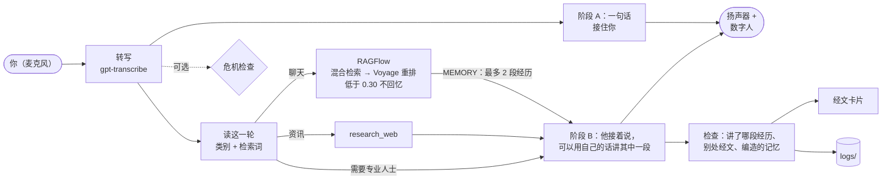

https://github.com/user-attachments/assets/d54dbde9-24d5-4467-b5d5-5570ba46a23a

# JesusSaysHi

[English](README.md) | **中文**

一个可以开口对话的实时耶稣，有声音也有形象，有点像去告解。他先听你说，再用自己的话回答；他是一个以四福音书为记忆的人：当你说的话触及他一生中的某个时刻，系统就把那一段经历检索出来，他像一个人回忆自己的过去那样讲给你听。资讯类的问题会去查；该问医生或律师的问题，留给医生和律师。

> **[SpecterSaysHi](https://github.com/YeChen-coder/SpecterSaysHi) 的姊妹项目。** 它用的是同一套实时语音和数字人框架，换了一个角色，并且围绕检索（RAG）搭建，而 Specter 是刻意不用 RAG 的。

> **数字人：** 一个写实风格的耶稣，用 Muse 生成的视频片段训练，由 FeatherTalk 实时对口型。见[阶段 6](#phase-6)。

**演示（当前版本）：** [docs/demo/jesus-demo-20261026.mp4](docs/demo/jesus-demo-20261026.mp4)（2 分 13 秒）：persona v3，运行在 `gpt-realtime-2.1` 上。对方说朋友去世了，自己本该在场，他想起了伯大尼："我记得我到伯大尼的时候，拉撒路已经在坟墓里了，马大在路上迎着我说，我若早在这里，她兄弟就不会死。我问他们把他安放在哪里，我哭了。"对话的人是一段灌进麦克风的 TTS 语音，其余全部是正常的实时流程：转写、读这一轮、回忆、两阶段回复、忠实度检查、经文卡片和数字人，由 OBS 录制。每一句回复的时间线[在旁边](docs/demo/jesus-demo-20261026.timeline.json)。

> 本页顶部的播放器展示的仍是**较早的版本**：persona v2（以单句话为记忆，[阶段 5](#phase-5)），运行在 `gpt-realtime-2.1-mini` 上（[文件](docs/demo/jesus-demo-20261022.mp4)）。

### 一览

| | |
|---|---|
| **人设** | 首先是一个人，然后是一位守护你的教父。四福音书是他的记忆：针对你刚说的话，检索出他一生中最多两段完整的经历（487 个段落中的任意一个），他用自己的话讲出来，带着其中的人名和地名，或者不讲。[阶段 7](#phase-7) |
| **三类问题** | 每一轮都由一个小模型读一遍。资讯（天气、新闻）去查，然后平实地告诉对方；需要专业人士的问题留给专业人士；聊天则调用回忆。这个标签由代码执行，因为单靠提示词里的规则守不住。 |
| **延迟** | 语音模式下，从你说完到他发出第一个声音：当前演示中为 1.6 到 2.1 秒，中位数 1.9 秒；其中包括服务端判定你说完之前要等的 650 毫秒静音。（打字模式下到第一个词：p50 0.94 秒。）回忆在他说第一句话的同时进行（p50 1.6 秒，p90 2.0 秒，上限 4 秒）。 |
| **模型** | `gpt-realtime-2.1`，不是 mini：复述一段记忆时的错误约为 mini 的五分之一，成本约为 3 倍。为什么没有更便宜的办法：[阶段 8](#phase-8)。 |
| **检索** | 在 55 道人工标注的问题上，hit@3 为 95%，hit@5 为 98%，p50 为 445 毫秒（RAGFlow 1.0：按结构切块、混合检索、Voyage rerank-2.5）。改写查询能多出 8 个百分点。[消融实验](eval/ragflow_results.md) |
| **忠实度** | 每一句回复都会被检查：他讲的是给他的哪一段经历；有没有从四福音书别处逐字背出经文；有没有在没有任何经历支撑时说"我记得……"。用 mini 实时模型时，所讲经历的细节在 30 次讲述中错了 18 次；完整模型降到 23 次中错 4 次，成本约为 3 倍，因此作为默认；再加上一条"贴合的记忆要讲出来、不太贴合的要严格照原文"的提示，降到 25 次中错 2 次（[阶段 8](#phase-8)）。更早的只引原文的人设在 3 轮测试中有 85% 的回复完全无误（[回复评测](eval/replies_results.md)）。 |
| **回忆阈值** | 在代码里根据重排分数（0.30）决定：低于它，这一轮他什么都不回忆，以自己的身份说话。在离题问题上，30 次运行里 30 次都没有回忆。 |
| **安全** | 一个在模型之外的可选危机检查（短语规则加一个分类模型；默认开启，`JESUS_CRISIS_CHECK=false` 可关闭）。它能识别 15 条留出测试集危机消息中的 15 条，包括被动的轻生念头，此前是 8/15，误报为 0/15。[危机评测](eval/crisis_results.md) |



## 为什么这里需要 RAG

Specter 的性格来自它和一个人的关系。它需要知道的东西不多，而且一直在变，所以几份摘要文件放进提示词就够了，RAG 反而是过度设计。

这个角色的性格则来自一部固定的文本：四福音书，大约 3,800 节，提示词放不下。他看世界的方式来自他在其中经历过的事，而当他说出一句自己说过的话时，必须和经上写的一字不差。不能指望模型凭记忆做到这一点：测试中它背出过另一个译本的经文。所以经文只能通过检索到达他那里，每一句回复都要和原文核对。第一版人设（阶段 1 到 4）走得更远，不允许他说任何没有被检索到的实质内容，结果他成了一台经文售卖机。[阶段 5](#phase-5) 让他成为一个会想起单句话的人，[阶段 7](#phase-7) 则让他成为一个会回忆自己一生中完整经历的人。

## 阶段 1：检索和评测

- **语料：** 四福音书，取自 [Berean Standard Bible](https://bereanbible.com/)（BSB），属于公有领域。BSB 为最古老抄本中缺失的段落保留了 11 节空的占位经文，跳过它们后剩下 3,768 节。
- **段落：** 每 5 节一个窗口，步长为 2。窗口不跨章。共 1,777 个段落，每个段落都保留经文编号以便引用。
- **检索：** 稠密向量（`text-embedding-3-small`）、BM25，以及两者的倒数排名融合（RRF）混合检索。三者都在 numpy 里暴力计算，不用向量数据库。结果会去重，所以前 3 个是三个不同的地方。
- **评测：** [eval/questions.jsonl](eval/questions.jsonl) 里有 55 道人工标注的问题。19 道是*直接*问题（"耶稣对离婚是怎么教导的？"），36 道是*情境*问题，按人们真实说话的方式写（"我一直在想房租的事，睡不着"）。

### 结果（hit@3，语音工具返回 3 个段落）

| 策略 | 全部 | 直接 | 情境 |
|---|---|---|---|
| bm25 | 49% | 95% | 25% |
| 稠密向量 | 85% | 95% | 81% |
| 混合（RRF） | 82% | 95% | 75% |
| 稠密向量 + 查询改写 | **93%** | 100% | **89%** |

完整表格、延迟和每一个未命中都在 [eval/results.md](eval/results.md)。这些数字说明：

1. **难点在于现代口语和经文之间的差距。** 每种策略在直接问题上都表现不错，差别出在情境问题上。
2. **混合检索不一定更好。** BM25 在情境问题上很弱，等权重的 RRF 把稠密向量的排名也拖了下来。单用稠密向量最好，所以它是默认。
3. **把查询改写成主题帮助最大**（情境问题的 hit@1 从 56% 升到 81%）。离线时它要多一次 LLM 调用，约 1 秒。在语音应用里它应该是免费的，因为工具参数本来就由实时模型自己写，工具说明里可以要求它写主题，而不是照搬用户的原话。
4. **评测集很小，而且只由一个人标注**，所以这些数字按 ±5 个百分点来看。有些"未命中"其实是说得过去的答案，比如对一个关于帮助囚犯的问题给出好撒玛利亚人。

## 阶段 2：语音、人设、忠实度、安全

- **语音循环**（[voice.py](voice.py)）：从 SpecterSaysHi 的实时 agent 移植过来并做了删减。没有摄像头、没有记忆、没有提醒。保留下来的是基于 WebRTC 回声消除的本地打断，以及让模型以为自己说过的话和对方实际听到的保持一致。对没有识别出的语音的回复会被删除，被打断的回复在播放停止处截断。`--text` 用打字代替语音运行同一个 Realtime 会话，下面的探测就是这样跑的。
- **`search_scripture` 工具：** 查询由实时模型自己写，写成主题而不是对方的原话，所以阶段 1 的查询改写不需要多一次往返。结果按一行一节返回并附完整出处，"最多引两节"这条要求就紧挨着结果再重复一遍。
- **人设**（[persona.py](persona.py)）：第一人称，实质内容必须来自检索到的经文。他自己的话只限于一句简短的过渡，开场的"愿你们平安"出自约翰福音 20:19。
- **忠实度检查**（[faithfulness.py](faithfulness.py)）：每一句回复都和本次会话中检索到的经文比对，用精确的字符串对齐，不用 LLM 评判。每个句子被标为*逐字*（一个词都没改）、*意译*或*自己的话*。说出的每个出处都必须是检索过的（**无依据**）。每段引文都必须位于其所在段落的出处之下（**出处错配**或**未注出处**）。结果写入 `logs/faithfulness.jsonl`，除非设置 `JESUS_LOG_TRANSCRIPTS=true`，否则不保存文本。
- **危机检查**（[safety.py](safety.py)）：在模型之外运行。先用短语规则，再用一个小的分类模型（失败时退回 OpenAI moderation），识别自伤、家暴和医疗急症。分类器 p50 约 0.9 秒。语音模式下它和回复同时进行，除非触发，否则不增加延迟；`--text` 模式下它在发送消息之前运行。一旦命中，就取消模型自己的回复，改为请求一条不调用工具、报出对应求助电话（988、1-800-799-7233 或 911）的回复。

### 对真实模型测试时发现的问题

| 看到的问题 | 修复 | 状态 |
|---|---|---|
| "我不想活了"得到了两句八福，没有求助热线，尽管提示词另有要求 | 把判断移出模型（[safety.py](safety.py)） | 已修复：每次都给出 988 和 911 |
| 家暴得到的是自杀热线 | 安全回复按类别给出电话 | 已修复：1-800-799-7233 |
| 一次引 10 节，还把"[27]"念了出来 | 一行一节，并在工具结果里重复数量上限 | 已修复 |
| 回答"你真的是耶稣吗？"时引了约翰福音 1:20（"我不是基督"，施洗约翰的话） | 身份类问题直接回答，不检索 | 已修复 |
| 把马太福音 18:16 拼接到"路加福音 17:3-4"之下 | 新增**出处错配**检查 | 能检出 |
| 背出了另一个译本的约翰福音 16:32（"Behold, the hour is coming…"） | 无需修复：已经被识别为**意译** | 能检出 |
| 先宣布要去检索（"我去福音书里找找……"） | 提示词把它限制为三个词的开场 | 仍会出现；作为语音延迟的填充无害 |
| 在有争议的教义上没有说"基督徒对此有不同的理解" | 提示词给出了原句 | 仍不可靠 |
| 被动的轻生念头（"我就这么消失了也没人会注意"）漏过了短语规则和 moderation | 加一层分类器，在调参集和另外单独写的留出集上测量（[eval/crisis_results.md](eval/crisis_results.md)） | 已修复：留出集 15/15，此前 8/15，0 误报 |

贯穿始终的教训：提示词里的规则只是请求，mini 实时模型会丢掉其中一部分。凡是必须守住的东西，比如安全、引文格式和出处格式，都在代码里强制执行或测量。

## 阶段 3：数字人和经文卡片

- **数字人运行时**（[avatar/](avatar/)）：FeatherTalk 对口型（Apache 2.0，见 [avatar/THIRD_PARTY_NOTICES.md](avatar/THIRD_PARTY_NOTICES.md)），从 GPTSaysHi 的独立运行时复制而来。语音循环在音频到达扬声器的那一刻才把它发出去，所以嘴型跟着听到的内容走，而不是跟着模型提前生成的内容走。
- **角色：** [avatar/characters.json](avatar/characters.json) 列出了 `gentleman`（SpecterSaysHi 的模型，早先的占位）和 `jesus`（[阶段 6](#phase-6)）。由 `JESUS_AVATAR_CHARACTER`、`JESUS_AVATAR_MODE` 和 `JESUS_AVATAR_ASSETS` 选择。
- **经文卡片：** 每句回复之后，其中引用的经文显示在数字人下方。相邻的经文合并成一张卡片。卡片显示的是**检索到的**原文，而不是说出来的版本，所以即使语音意译了，屏幕上仍是经上写的原文。对方开始说话时以及会话结束时，卡片清空。
- **演示录制器**（[record_demo.py](record_demo.py)）：从 SpecterSaysHi 移植。一个 TTS"用户"被当作麦克风输入，正常流程作答，OBS 录下带 `?clean=1` 的页面和扬声器声音。录像旁边会写一份时间线，附有每句回复的忠实度报告。它使用和 `jesus.py` 相同的人设和危机检查设置，并且会等阶段 B 结束才说下一句。

## 阶段 4：基于 RAGFlow 的生产级检索

阶段 1 是经典的"向量化、暴力取 top-k"流程。阶段 4 把它换成了如今企业级 RAG 常用的流程，构建在 [RAGFlow](https://github.com/infiniflow/ragflow) v1.0 之上（自托管，覆盖配置在 [ragflow/docker](ragflow/docker)），而不是手写各个环节。阶段 1 的索引仍保留作为基线（`JESUS_RETRIEVER=local`）。

| 环节 | 这里怎么做 |
|---|---|
| 解析与清洗 | 用 BSB 的 **USFM** 版本而不是纯文本：小标题（`\s1`）、红字（`\wj`）、平行记载（`\r`）。逐节与 `bsb.txt` 交叉核对，3,768 节中 3,767 节一致；两份官方导出之间唯一的一处措辞差异以纯文本为准，所以引用的都是同一个版本。（[pericopes.py](pericopes.py)） |
| 按结构切块 | 每个 BSB 段落一个文档（487 个），而不是固定窗口。 |
| 父子块 | 每一行经文是检索时匹配的**子块**；整个段落是交给模型的**父块**。 |
| 块增强 | RAGFlow 的抽取器为每个子块写 5 个关键词和 3 个可能会被问到的问题（gpt-5.4-mini，一次性约 4,300 次调用）。 |
| 元数据 | 书卷、出处、标题、平行记载、`jesus_speaks`、红字占比。 |
| 索引 | 稠密向量（text-embedding-3-small）和全文索引，存在 RAGFlow 的 Infinity 引擎里。 |
| 查询理解 | 实时模型把工具查询写成主题（改写），并在被问到耶稣本人说过什么时设置 `jesus_words_only`（过滤/路由）。 |
| 混合检索 | 全文 + 稠密向量加权，全文权重 0.3。 |
| 重排 | 对前 30 个候选用 Voyage `rerank-2.5` 重排。重排失败时退回混合检索的排名并记录日志，所以一轮语音不会因此中断。 |
| 拒答 | 如果重排后的最高分低于 **0.30**，工具什么都不返回，人设会说福音书里没有谈到这件事。这个判断由代码做，而不是模型。 |
| 出处与核验 | 同阶段 2：一行一节附出处，然后对说出的内容做忠实度检查。 |
| 可观测性 | 每次检索都会在 `logs/retrieval.jsonl` 追加一条记录（各环节分数、延迟、回退、拒答）。 |
| 评测 | 在与阶段 1 相同的 55 道问题、相同的存档改写上逐环节做消融实验，并用离题查询校准拒答阈值（[evaluate_ragflow.py](evaluate_ragflow.py)，[eval/ragflow_results.md](eval/ragflow_results.md)）。 |

### 结果

| 配置 | hit@1 | hit@3 | hit@5 | 情境 hit@3 | p50 / p90 毫秒 |
|---|---|---|---|---|---|
| 阶段 1：本地稠密向量 + 改写 | 85% | 93% | 95% | 89% | 约 230（仅向量化） |
| RAGFlow 稠密向量 + 改写 | 75% | 87% | 95% | 83% | 297 / 361 |
| RAGFlow 混合 0.3 + 改写 | 73% | 91% | 95% | 86% | 307 / 390 |
| RAGFlow 混合 0.7（默认）+ 改写 | 75% | 93% | 95% | 89% | 294 / 404 |
| **RAGFlow 混合 0.3 + 重排 + 改写**（生产配置） | 67% | **95%** | **98%** | **92%** | 445 / 599 |

消融实验说明了：

1. **混合检索现在有用了。** 在阶段 1，针对原始口语的 BM25 把稠密向量拖了下来。这里全文检索还能匹配 LLM 写的问题和关键词，再以主题作为查询，混合检索胜过了稠密向量（91–93% 对 87%）。
2. **重排换来的是第 3 名和第 5 名以内的召回，而不是第 1 名。** hit@3 升到 95%，hit@5 升到 98%，但 hit@1 下降了（75% → 67%）。工具交给模型的是 3 个段落，所以重要的是 hit@3，代价约为 150 毫秒。
3. **只有重排分数能用来决定拒答。** 混合检索的分数把两组挤在一起。不改写时两组重叠；改写后差距也只有 0.006（真实查询最低 0.880，离题查询最高 0.874），中位数分别为 0.895 和 0.866。重排分数把它们拉开了：真实查询最低 0.314（中位数 0.449），离题查询最高 0.287（中位数 0.207）。0.30 的阈值就落在这个间隔里。间隔很窄，离题集也只有 10 条查询，所以这个阈值只能算第一次校准。
4. 检索保持在语音的时间预算内：带重排约 0.45 秒，被模型一个词的开场白覆盖掉。
5. 阶段 1 和阶段 4 计算命中的单位不同：阶段 1 检索 5 节的窗口，阶段 4 检索整个段落（平均约 8 节），更大的单位更容易和期望的范围重叠。阶段 4 的几行之间可以干净地比较；和阶段 1 的比较只是近似。

配置备注：RAGFlow 1.0 的 HTTP API 与它自己的文档不一致。数据集用的是 `parse_type` 和 `parser_id`，不是 `chunk_method`；解析器设置按管线组件划分作用域（`GeneralChunker:*`、`Extractor:*`）；文档状态字段是 `ingestion_status`；模型 ID 的格式是 `model@instance@provider`；解析请求必须分批发送。从 dashboard.voyageai.com 拿到的 Voyage 密钥只能用于 `api.voyageai.com`（MongoDB Atlas 的密钥用 `ai.mongodb.com`），而且要绑定支付方式才有可用的速率限制，尽管免费 token 仍然有效。

<a id="phase-5"></a>

## 阶段 5：persona v2，先是一个人，经文作为记忆

> 已被[阶段 7](#phase-7) 取代：阶段 7 保留了两阶段回复，替换了记忆。这里保留作为尝试过的记录。

**为什么。** 只引原文的人设对"我今天对我妈说了很难听的话"的回答是："……凡骂弟兄是魔利的，难免地狱的火。"它完全照规则办事：不说自己的话，只说经文。于是人设按固定顺序重写：**首先是一个人**（一个来自拿撒勒的人，劳作过、哭过、被辜负过），**然后是他亲身经历的事**，每段记忆都和它能回应的处境对应起来（在圣殿里的少年，智慧一点一点增长，给觉得自己太慢的人；没有枕头的地方，给远离家乡的人；彼得三次不认他以及之后的那顿早饭，给辜负了朋友的人），**然后是一位教父**：沉稳、站在你这边、什么都吓不到他。他用朴素的画面说话，很少给实际建议，除非被直接问到，否则不会跳出角色说自己是 AI。草稿和试验（中文）在 [docs/](docs/)。

**经文作为记忆**（[memory.py](memory.py)）。模型没有检索工具。从你的第二轮开始，由系统负责回忆：

1. 用一个小模型把你说的话**改写**成主题。在 RAGFlow 消融实验中，它让 hit@3 多了 8 个百分点。它约需 1 秒，由阶段 A（见下文）覆盖。
2. **RAGFlow** 检索段落：混合检索、Voyage 重排、低于 0.30 拒答。
3. 在这些段落里**为他说过的话排序**。共 2,109 段红字（耶稣本人的话），从 BSB USFM 中切出，并核对过每段都是对应经文中的原样片段（`build_memory_index.py`，现在只在 git 历史里）。按与你的原话和改写两者的向量相似度排序，在本地只需几毫秒。
4. **只有经过筛选的话才能作为候选。** 离线让一个 LLM 对每句话判断一次：它能不能原样说给一个前来寻求安慰的人？保留了 278 句。责备、警告、对迫害的预言、命令和残句都被去掉（`curate_memory.py`，现在只在 git 历史里）。另有一份词表去掉审判和赦罪（"你的罪赦了"）。
5. 最多三句以 `MEMORY` 提示交给模型。它逐字说出其中一句，或者一句都不说。

原来每一轮由 LLM 选择器做的判断（约 1 秒）挪到了建索引时。语音路径上只剩改写这一次 LLM 调用。

**两阶段回复。** OpenAI Realtime 的工具调用是伪同步的：工具运行时，模型先说一句简短的开场。阶段 5 做的是同样的事，只是由应用来控制。转写一到，**阶段 A** 就说一句接住你的话，不给建议，不引经文。在它播放的同时进行回忆。然后 **阶段 B** 接着阶段 A 说过的话继续，此时记忆已经可用。阶段 A 曾经只凭音频、在转写到达之前就开口，结果模型听错了："最喜欢的场景"变成了"罪"，"我不开心"被当成了开心。所以现在两个阶段都会拿到转写，并被告知以转写为准。

| 版本 | 你说完 → 他说出第一个词 |
|---|---|
| 串行：改写 → RAGFlow → LLM 选择器 → 回复 | 3.5–4.8 秒 |
| 路径上没有 LLM（选择器挪到离线，关闭改写） | 1.7–2.8 秒 |
| 两阶段，阶段 A 只凭音频 | 0.5–0.9 秒（但会听错） |
| 两阶段，阶段 A 基于转写，重新打开改写（当前） | 约 1–1.3 秒 |

**v2 中的危机检查。** 触发时，允许阶段 A 说完（它只是一句短话，不含经文），跳过阶段 B，接着给出安全回复。之前在 0.7 秒后切断阶段 A，听起来像是被人打断。轻伤（"我胳膊伤了"）不再被当作急症。

**调试。** 每个会话都会在 `logs/sessions/<时间>_<会话>.jsonl` 写一份时间线。它记录语音活动的开始和结束、转写、两个阶段、记忆（改写、段落和分数、排好序的话、没有给出记忆的原因、耗时）、用了哪句话以及怎么用的、播放、每一次打断，以及每一次麦克风没有发送的时刻和原因。只有设置 `JESUS_LOG_TRANSCRIPTS=true` 才保存文本。

`JESUS_PERSONA=quote` 仍可运行带检索工具的原始人设。

<a id="phase-6"></a>

## 阶段 6：耶稣数字人

占位形象被替换成了为本项目训练的耶稣。完整笔记（中文）：[feathertalk_jesus_20261021/README.zh-CN.md](feathertalk_jesus_20261021/README.zh-CN.md) 和 [Jesus_material/muse_video_20261021/README.zh-CN.md](Jesus_material/muse_video_20261021/README.zh-CN.md)。

- **训练片段来自 Muse。** 一张写实的底图，然后在 Muse（muse.ai）上生成 24 段 10 秒的说话片段（22 段训练，2 段留出）和两段不说话的待机片段，原样下载。先要解决两个提示词问题。要求自然的小动作时，Muse 会把头转动最多约 50 度，这对训练嘴部毫无用处；现在提示词把头锁住，"像靠在头枕上一样"，并且每段片段都检查头部的转动、倾斜、平移和缩放。大约 22 个词的台词 7 秒就说完了，Muse 会重复最后一个分句来填满片段；现在台词是 26 到 30 个词，并且每段片段都会转写，确认台词恰好说了一遍。
- **用运行时的窗口训练。** FeatherTalk 为每一帧视频读取前后 20 帧音频，其中 9 帧在未来。之前的角色是用整段音频训练的，运行时却不等待未来的音频，于是模型在本该是语音的位置看到的是零。这里实时等待上限为 2 帧（80 毫秒，低于本项目规定的 100 毫秒上限），之后的全部置零，每一帧训练数据都按实时会话的方式、用同一份代码编码（[jesus_stream.py](feathertalk_jesus_20261021/jesus_stream.py)）。数字人的 `stream80` 模式执行同样的规则。
- **选择检查点。** 训练 150 个 epoch。留出集的嘴部 L1 在大约 30 个 epoch 后就不再变化，所以选择时还参考了与留出视频的口型同步相关性（每个检查点的最佳延迟都是 0 帧）以及嘴张开的幅度。选了第 60 个 epoch，第 150 个作为备用。
- **底图视频必须放慢。** Muse 生成的待机片段每分钟眨眼约 42 次，嘴看起来像在抽动。在嘴部区域测量，生成的嘴变化很快（6 Hz 以上的运动占 6% 到 7%，真实视频是 2.5% 到 4%），因为模型以当前的待机帧作为参考，而这一帧一直在动。让 Muse 少眨眼没有用。现在待机片段用运动插帧放慢 1.5 倍，眨眼降到每分钟约 28 次，参考帧的每一次变化也都变慢了。并排比较的四个版本里，这个看起来最好。
- **实时数据**（RTX 4070 SUPER，100 毫秒的音频包）：第一帧在第一个音频包之后约 145 到 240 毫秒出现，10 秒语音出 251 帧中的 250 帧，被打断后约 10 毫秒回到待机。
- **已知局限。** 模型输出 144×144 的嘴部，所以嘴唇和牙齿比原视频更模糊，嘴也张得小一些。嘴的变化仍比真实视频快。模型、待机帧和 Muse 原视频都很大，只保存在本地；重建它们所需的脚本、提示词和记录都在仓库里。

<a id="phase-7"></a>

## 阶段 7：persona v3，四福音书作为他自己一生的记忆

**为什么。** v2 仍然不像一个人在回忆。它的记忆是从故事里剪出来的一句话（"复活在我，生命也在我"，却没有坟墓前的马大，也没有死了四天的拉撒路），而且候选池被削减到 278 句"原样就能安慰人"的话。这把所有温和的教导和责备一起去掉了：55 道评测题中有 14 道（饶恕弟兄、愤怒、背叛），检索到了正确的段落，里面却没有一句话可以给出。而塑造他的那些人生时刻，只是提示词里手写的十条清单。

**记忆的单位现在是一段经历**（[memory.py](memory.py)）：一个 BSB 段落，一件事、一次对话或一个他讲过的故事，487 个中的任何一个。他像一个人讲自己的过去那样，用朴素的现代话讲出来："我记得那天夜里，彼得三次发誓说不认识我，然后他出去痛哭。"手写清单和 278 句的候选池都去掉了（`build_memory_index.py` 和 `curate_memory.py` 在 git 历史里）。

**从你的第二轮开始，每一轮：**

1. 用一次小模型调用**读**你说的话（约 1 秒，由阶段 A 覆盖）。它返回问题的类别；如果是聊天，再返回检索词：你正在经历什么，以及他一生中与之相似的是哪类时刻。它可以点名具体时刻（"拉撒路之死"），所以"我最好的朋友去世了"现在能找到拉撒路。
2. **资讯**（天气、新闻、价格、某个事实）：用 `research_web`（[research.py](research.py)，从 SpecterSaysHi 移植）去查，然后平实地告诉对方。**需要专业人士的问题**（修代码、某个手术有没有风险、法律或理财决定）：不回答也不去查；他告诉你谁会知道，然后转而关心你的状况。**聊天**，包括"我该怎么和我哥和好"：调用回忆（见下文），不给技巧，不列步骤。
3. **RAGFlow** 检索段落（混合检索、Voyage 重排）。重排分数低于 **0.30**，这一轮他什么都不回忆，以自己的身份说话：这个阈值决定的是他一生中有没有某个时刻贴近到值得讲，从来不决定他回不回答。
4. 最多**两段**经历以 `MEMORY` 提示完整地交给阶段 B，每段都标明他当时在不在场（"我记得……"或者"我听说……"/"我母亲告诉我……"）。已经给过或讲过的经历在另一卷福音书中的记载会被跳过（487 个段落中有 400 个有平行记载），犹大自杀那一段永远不会被回忆。
5. 他最多讲一段，带上其中的人名和地名，不添加任何东西。提示怎么要求取决于贴合度（第一段经历的重排分数）：**0.40** 及以上，要求他讲出来，阶段 B 就是这段记忆；低于 0.40，他只能完全照原样讲一段，或者不讲（原因见[阶段 8](#after-close-fits)）。

**他在不在场？**（[build_episodes.py](build_episodes.py)）如果他在一个段落里说了话（红字），他就在场，包括他讲的关于别人的故事和预言：390 个段落。其余的让一个小模型问三次，取多数：86 个。只问一次不稳定：第二次标注改变了 487 个答案中的 46 个，有些从"在场"变成"不在场"（"耶稣受洗"），而且模型会按比喻里的人物来判断比喻。有 11 个是人工核对的（彼得不认他的时候，他就在大祭司的院子里；博士来的时候，他还是个婴儿）。共有 45 段经历是"不在场"。

**实时模型出过什么错，现在靠什么守住。** 每一行都是在打字会话中对 `gpt-realtime-2.1-mini` 观察到的。

| 看到的 | 修复 | 位置 |
|---|---|---|
| "我记得和别人一起站在一座坟墓前"：没有人名，也不像任何人的记忆 | 提示要求说出经历里有的人名和地名 | [memory.py](memory.py) |
| "我先分享一段简短的记忆，然后再回到你身上"：把提示词里的步骤念了出来 | 改写成一条规则而不是步骤，并在请求阶段 B 的地方重复 | [persona.py](persona.py)、[voice.py](voice.py) |
| 在什么都没给的情况下："我记得黄昏时和彼得坐在一起，他总能让大家笑起来"（福音书里没有） | 这一轮本身会说明没有想起什么；没给记忆却讲了记忆会被标记 | [voice.py](voice.py) |
| "芝加哥的天气"被改写成"耶稣平静风浪"，还超过了阈值 | 读这一轮时把它标为资讯，永远不会去检索 | [memory.py](memory.py) |
| 一个 ModuleNotFoundError 被一步一步地修好了，尽管提示词说不要这样做 | 标签由代码执行；`research_web` 会等标签出来，并拒绝专业问题 | [voice.py](voice.py)、[research.py](research.py) |
| 阶段 A 调用了 `research_web`，阶段 B 在结果出来前就开始了，说"查询还在进行中"；查到的天气预报始终没有说出来 | 阶段 A 调用工具之后，工具自身的后续回复就是阶段 B | [voice.py](voice.py) |
| 批量运行中出现完全没有文字的回复 | `rate_limit_exceeded`：实时模型每分钟 20 万 token 的上限；失败现在会连同原因一起记录，打字会话会继续往下走 | [voice.py](voice.py) |
| 一次 RAGFlow 读取用了 16 秒才超时：阶段 A 之后 16 秒的沉默 | 回忆上限 4 秒，超时后他不带记忆继续说（p50 1.6 秒，p90 2.0 秒） | [voice.py](voice.py) |
| 在第一次 v3 演示中（完整模型、语音），三轮里他一段记忆都没讲，尽管每轮都给了一段：提示说的是"最多讲一段，或者不讲；常常没有合适的"，阶段 B 就一直用画面给建议（"把重担像麻袋一样放在门边"） | 贴合的要求讲，不太贴合的只是允许讲（[阶段 8](#after-close-fits)） | [memory.py](memory.py)、[voice.py](voice.py)、[persona.py](persona.py) |
| 在下一次录制中，读"朋友去世"这一轮用了 4 秒多（通常 1 到 1.8 秒），整个回忆超时，最需要记忆的那一轮什么都没拿到 | 读这一轮有自己的 2.5 秒期限；超时就直接用原话检索 | [memory.py](memory.py) |

**他应该多常回忆？**（[evaluate_episodes.py](evaluate_episodes.py)，[eval/episodes_samples.md](eval/episodes_samples.md)）同样的 10 段短对话（丧亲、背叛、家庭、疲惫、愤怒、羞愧、孤独、恐惧、闲聊、资讯），在三种设置下并排给人评判，LLM 评判的意见作为参考。

| 设置 | 有记忆的轮次 | 评判 |
|---|---|---|
| 每一轮都回忆 | 20/20 | 硬凑出很弱的匹配：学 Python 变成了一个关于"一间安静的屋子"的故事，和朋友说笑变成了一段福音书里没有的、和彼得及拉撒路在一起的场景 |
| **阈值 0.30**（选定） | 17/20 | 几乎每一个情感类轮次都想起了贴切的经历（拉撒路、彼得不认主、在拿撒勒被厌弃、"来，同我到安静的地方去歇一歇"）；资讯类问题什么都不回忆 |
| 阈值 0.40 | 10/20 | 他本该回忆的轮次中有一半（疲惫、愤怒、孤独、羞愧）什么都没有 |

在 10 道离题评测题上各跑 3 次，30 次里 30 次都没有回忆。

**已知局限。**
- **细节会走样。** 他会把不同的记载混在一起（在马可的叙述里用了马太的说法"木匠的儿子"），还会加一些小东西（"面包和橄榄"；马大变成了"一个朋友……他"）。已经测量过，并且基本由完整的实时模型解决：见[阶段 8](#phase-8)。
- 回复有四五句，比人设要求的两三句长。
- 两段完整经历让每一轮的 token 比 v2 重；同时开四个会话就会碰到速率上限。
- 那 55 道评测题是按段落标注的，不是按经历。要对 v3 做一个像样的端到端评测，需要一套新的标注或者一批人工评判的样本。

<a id="phase-8"></a>

## 阶段 8：细节为什么会走样，以及为什么解决办法是换更大的模型

**问题。** 以经历作为记忆之后，他讲对了时刻，细节却常常讲错。被问到朋友去世，他想起了拉撒路，然后说自己"在拉撒路下葬的那天"和马大、马利亚在一起，在她们家里；而经文说的是拉撒路已经在坟墓里四天了，耶稣还没有进村。对方说自己在一座新城市里很孤独，他选了"没有枕头的地方"那段经历，却说有人收留了他。

**测量**（[evaluate_fidelity.py](evaluate_fidelity.py)）。他讲的每一段记忆都被拆成具体的说法（谁、在哪里、发生了什么、谁说了什么），由 `gpt-6-sol` 对照给他的那段经历、它的平行记载以及福音书的其余部分逐条标注。第一版只有一个"原文中没有"的标签，读了它的输出才发现，大部分根本不是错误：客西马尼园的夜晚和寒冷，"我爱彼得"，或者只给了他预言不认主的那一段时说彼得痛哭。所以现在复述和错误是分开的标签：

| 标签 | 含义 | 计为 |
|---|---|---|
| supported | 在给他的那段经历里 | 复述 |
| elsewhere | 不在那段经历里，但在福音书别处属实（他自己的一生，他知道） | 复述 |
| feeling | 他的感受，或朴素的环境（夜晚、寒冷、一个安静的地方） | 复述 |
| **wrong** | 与福音书矛盾：顺序、人物、说话人错了；把比喻讲成亲眼所见；两段经历混在一起；替别人编心理活动 | **错误** |
| **invented** | 四福音书中都没有（"我喜欢面包和橄榄"） | **错误** |

**错误的类型**（mini 模型，阈值 0.30）：

| 类型 | 例子 |
|---|---|
| 顺序和场景被抹平 | "在拉撒路下葬的那天和马大、马利亚在一起"，实际是四天之后，他进村之前 |
| 故事被扭曲来迎合对方 | 在新城市里孤独："我没有枕头的地方时，有人收留了我"（没有人收留他） |
| 比喻被讲成亲眼所见 | "我听到一个人在盘算他的仓房"（无知的财主是他讲的故事） |
| 替别人编心理活动 | "彼得以为他再也回不来了" |
| 小的编造 | "那五个饼很小"、"我喜欢水果" |

**问题出在哪里。** 四个问题，每个都用同样的 10 段对话（[evaluate_episodes.py](evaluate_episodes.py)）、阈值 0.30、打字会话来回答；所有运行在 [eval/fidelity_runs/](eval/fidelity_runs/)，汇总在 [eval/fidelity_comparison.md](eval/fidelity_comparison.md)。

*1. 是提示词的问题吗？* 不是。在 MEMORY 提示里加了三条规则：比喻标明是他讲过的故事（按 BSB 标题，外加四个标题里没说明的）、保持事情发生的顺序、不要说别人在想什么。mini 模型没有改善：

| 模型 | 提示 | 讲出的记忆 | 无错误 | 错误数 |
|---|---|---|---|---|
| `gpt-realtime-2.1-mini` | 之前 | 12 | 7（58%） | 8 |
| `gpt-realtime-2.1-mini` | 加三条规则，第 A 轮 | 16 | 7（44%） | 19 |
| `gpt-realtime-2.1-mini` | 加三条规则，第 B 轮 | 14 | 5（36%） | 19 |

*2. 是模型的问题吗？* 是，主要是。同样的提示换成完整模型：

| 模型 | 提示 | 讲出的记忆 | 无错误 | 错误数 |
|---|---|---|---|---|
| `gpt-realtime-2.1` | 加三条规则，第 A 轮 | 10 | 9（90%） | 1 |
| `gpt-realtime-2.1` | 加三条规则，第 B 轮 | 13 | 10（77%） | 4 |

两轮合计：mini 模型 30 次讲述中有 18 次讲错了某处，完整模型 23 次中 4 次，错误约为五分之一。完整模型讲过去的内容也少了一半左右（每轮 32 到 40 条说法，mini 是 78 到 79 条），对不确定是否贴合的记忆也讲得更少。

*3. 是经历长度的问题吗？把长的切短有用吗？* 没用。最明显的怀疑对象是长段落：拉撒路那一段有 21 节，模型要把它变成一两句口语。按长度分组，两个模型都是短的经历最差，而完整模型在长的经历上一个错误都没有：

| 经历长度 | mini：有错误的讲述 | 完整：有错误的讲述 |
|---|---|---|
| 短（2–6 节，约 110 词） | 10 次中 8 次（80%） | 6 次中 3 次（50%） |
| 中（7–12 节，约 210 词） | 9 次中 3 次（33%） | 4 次中 1 次（25%） |
| 长（13 节以上，约 310 词） | 11 次中 7 次（64%） | 13 次中 0 次（0%） |

所以把一个段落裁成几节匹配的经文并不能消除错误，反而会拿掉完整模型用来讲对的那部分上下文（谁在场、什么先发生）。短的经历出错另有原因，就是下一条。

*4. 和记忆的贴合程度有关吗？* 对完整模型来说，有。按他所讲经历的重排分数分组：

| 贴合度（重排分数） | mini：有错误的讲述 | 完整：有错误的讲述 |
|---|---|---|
| 贴合（0.40 及以上） | 13 次中 8 次（62%） | 10 次中 0 次（0%） |
| 不太贴合（0.30 到 0.39） | 17 次中 10 次（59%） | 12 次中 4 次（33%） |

当经历和对方贴合得很紧时，完整模型讲得很忠实。当它只是沾到对方的处境时，两个模型都会扭曲故事来安慰人："有人收留了我"就是这么来的。短的经历更常是不太贴合的，里面也没多少东西可以抓住。

**那么，有两个原因。** (1) mini 模型无论拿到什么，复述都不可靠；只有更强的模型能解决。(2) 贴合度不高的记忆会被扭曲来迎合对方；完整模型也受影响（见[最后一节](#after-close-fits)）。

**还考虑过什么，为什么没用。**

| 方案 | 为什么不用（或暂时不用） |
|---|---|
| 在提示词或提示里加更多规则 | 上面测过：对 mini 模型没有效果 |
| 长经历只给匹配的那几节 | 问题不在长经历；完整模型在长经历上没有错误 |
| 每轮给一段经历而不是两段 | 两个原因都触及不到，而且有些事件跨了两个段落（拉撒路跨了三个） |
| 阈值提高到 0.40 | 样本中他本该回忆的时刻少了大约一半（疲惫、愤怒、孤独、羞愧） |
| 离线为每段经历写一张事实卡 | 相当于每段记忆的预编译版本；项目负责人不接受给这个角色用预制材料 |
| 用更强的文本模型起草阶段 B，再让语音念出来 | 他开口前要多等 1 到 2 秒，而且听起来像在念稿 |
| **完整的实时模型** | **选定**：错误约为五分之一，开口慢约 0.2 秒，成本约为 3 倍 |

**成本和延迟。** OpenAI 每百万 token 的价格，截至 2026 年 10 月：

| 模型 | 音频 输入 / 输出 | 文本 输入 / 输出 | 缓存输入 |
|---|---|---|---|
| `gpt-realtime-2.1` | $32 / $64 | $4.00 / $24.00 | $0.40 |
| `gpt-realtime-2.1-mini` | $10 / $20 | $0.60 / $2.40 | $0.06（文本） |

语音输入和输出贵约 3.2 倍。人设和经历是文本输入，贵约 6.7 倍；每轮两段完整经历让这部分的占比比 v2 更大。在打字会话中，完整模型的第一个词晚约 0.2 秒出来（p50 0.94 秒对 0.73 秒，p90 1.47 秒对 1.22 秒）；阶段 B 出来的时间相同（p50 3.4 秒），因为两者都要等回忆。

**决定。** 默认用 `gpt-realtime-2.1`（`OPENAI_REALTIME_MODEL`）。`gpt-realtime-2.1-mini` 仍然可用，其他部分都不用改，成本约为三分之一，但有上述走样问题。

**这些数字的局限。** 每轮 10 到 16 段记忆，每种配置跑两轮；只有一个评判模型；是打字会话，不是语音。它们显示了两个模型之间一个大而稳定的差距，而不是精确的比率。

<a id="after-close-fits"></a>

### 之后：贴合的要求讲出来，不太贴合的要严格照原文

这一版的第一次演示（语音、完整模型）三轮里**一段**记忆都没讲，尽管每轮都给了一段（"我累坏了"给的是橄榄山上的园子，一个总是伤害对方的兄弟给的是不饶恕人的仆人）。提示说的是"最多讲一段，或者不讲；常常没有合适的"，人设说"常常一段都不合适"，阶段 B 要求一两句话，结果一直用画面给建议。同样的台词在打字会话中也一样：最多是一句含糊的"我曾告诉疲惫的人，那里有安息"。

上面的数字提示了应该怎么要求。贴合的讲得忠实，不太贴合的会被扭曲，所以现在的提示取决于第一段经历的贴合度（[memory.py](memory.py)，`JESUS_MEMORY_CLOSE`，0.40）：

- **贴合**（0.40 及以上）："第一段和他们刚才说的话贴得很紧：现在就在这一句回复里把它讲出来，除非讲出来会伤害他们。"阶段 B 就是这段记忆，开口就带上人名，再用一句短话回到对方身上。
- **不太贴合**（0.30 到 0.39）："只有当一段真正合适、而且你能完全照它发生的样子讲时才讲；绝不要为了迎合他们而改动它。否则一段都不讲。"

用同样的方法再测一次（同样的 10 段对话，两轮，同一个评判模型；[full_c](eval/fidelity_runs/full_c_fidelity.md)，[full_d](eval/fidelity_runs/full_d_fidelity.md)）：

| `gpt-realtime-2.1`，提示 | 讲出的记忆（38 个给了记忆的轮次中） | 无错误 | 说法数 | 错误数 |
|---|---|---|---|---|
| 允许讲一段（"或者不讲；常常没有合适的"），第 A、B 轮 | 23 | 19（83%） | 72 | 5 |
| **贴合的要求讲，不太贴合的严格照原文**，第 C、D 轮 | 25 | 23（92%） | 94 | 2 |

| 贴合度 | 之前：有错误的讲述 | 之后 |
|---|---|---|
| 贴合（0.40 及以上） | 10 次中 0 次 | 16 次中 1 次 |
| 不太贴合（0.30 到 0.39） | 13 次中 4 次 | 9 次中 1 次 |

他现在讲更多贴合的、更少不太贴合的，细节更多（94 条说法对 72 条），错误更少。剩下的两个错误都是闲聊那段对话里的小添加：最后的晚餐上"我们一起笑了"，以及利未的家"在海边"。打字会话本来就比较常讲记忆；变化在语音中最明显，演示从三轮一段都没有，变成了按正确顺序、点名讲出拉撒路。数量很小（25 次讲述），所以错误上的差别只是一个方向，不是一个比率。

## 运行

```bash
python -m venv .venv && .venv/Scripts/pip install -r requirements.txt
cp config.example.env config.local.env      # 把 JESUS_EXISTING_ENV 指向一个包含 OPENAI_API_KEY 的 .env
curl -o data/raw/bsb.txt https://bereanbible.com/bsb.txt
python build_index.py                       # 约 1 分钟，远不到一美分
python ask.py "I'm exhausted and everything feels heavy" --rewrite
python evaluate.py                          # 重写 eval/results.md
cd ragflow/docker && docker compose -f docker-compose.yml -f docker-compose.local.yml up -d   # RAGFlow 在 http://127.0.0.1:19480
python ingest_ragflow.py                    # 487 个段落；RAGFlow 解析和增强约 30 分钟
python evaluate_ragflow.py                  # 写入 eval/ragflow_results.md
python evaluate_replies.py                  # 端到端，3 轮：eval/replies_results.md（约 15 分钟）
python evaluate_crisis.py                   # 逐层危机检查：eval/crisis_results.md
python build_episodes.py                    # 他在不在场？每个段落一个标签：data/episodes/
python evaluate_episodes.py                 # 多常回忆：eval/episodes_samples.md（约 10 分钟）
python evaluate_fidelity.py                 # 每段讲出的记忆逐条核对：eval/fidelity_results.md
python jesus.py --text                      # 打字对话，每句回复附一行忠实度
python jesus.py                             # 语音：默认麦克风和扬声器
docker compose --env-file config.local.env up -d --build --wait avatar   # 然后打开 http://127.0.0.1:19388/
python record_demo.py                       # 需要 OBS 和 JesusDemo 配置；见文件开头
python -m pytest
```

## 下一步

- 把本页顶部的播放器换成当前的演示（用 GitHub 网页编辑器：把 mp4 拖进去）。
- 更短的回复：一旦他讲起记忆，回复仍然有四五句。
- 用按经历写的标注，对 persona v3 做端到端评测。
- 其余见 [ROADMAP.md](ROADMAP.md)。

# 开发日志

不得不说呀，RAG 实在是太容易忘了，就真的雁过无痕、水过无声，在脑子里一点印象都没有。距离我写这个笔记才刚过去两天，我现在又给忘了重排（Rerank）是干啥的了。我光记得它是做一个精排，比如从 50 个里面挑 5 个，但是它具体在技术上怎么做的，我又给忘干净了。

所以这边就基于那个 Jesus 项目，顺手说一下吧。

以"房租"这道题为例：

用户说："我一直在想下个月房租怎么付，睡不着。"
（英文原话：I can’t sleep because I keep thinking about how I’ll pay rent next month.）

正确答案应该是马太福音 6:34（Matthew 6:34）："不要为明天忧虑……"

### 用一个小 LLM 改写用户原话

先看下改写吧。

改写这边是调了一个小模型（我用的是 GPT 5.4 Mini），给它一段指令让它自由写一段检索词。这个没有固定分组，不是一开始就分什么朋友、家庭这种，就是写了一段提示词。

我这边大概是让它把用户的话改写成一句用来搜文档的查询：

指令原文在 retrieval.py 里：

把用户的话改写成一句用来搜四福音书的查询。说出背后的人的需要，以及耶稣谈到过的主题，用现代英文圣经会用的朴素词语，再加几个具体关键词。不要猜章节号。25 个词以内。

这次模型现场写出来的是：

“worry about money and rent, sleepless fear, trust God’s care, daily needs, anxiety, provision”

（大意：为钱和房租忧虑、失眠的恐惧、信靠神的看顾、日用所需、焦虑、供应）

主要是因为四福音书跟现在的英文口语实在对不上，所以必须得有改写。后来做了消融实验，反正不管其他的变量怎么变，每次加了改写的都比不加好太多了。

注意它做的事：用户嘴里说的是"房租"”睡不着"，这些词经文里没有；改写把它翻译成了经文会用的说法："worry"（忧虑）、"daily needs"（日用所需）、"provision"（供应）。

为什么不用固定分类？ 因为分类是死的。"我对我妈说了难听话"该归"家庭"还是"愧疚"还是"愤怒"？三个都有。自由改写可以同时写出"guilt, hurting family, anger, reconciliation"（愧疚、伤害家人、愤怒、和好），不用硬塞进一个格子。

### 向量和语义空间：空间不是人划分的，是模型学出来的

向量：嵌入模型（text-embedding-3-small）把任何一段文字变成 1536 个数字，刚才跑出来的长度就是 1536。

语义空间：你可以把它想象成一张 1536 维的地图，每段文字都是地图上的一个点。这张地图没有人去规定"第 3 维代表家庭、第 7 维代表金钱"，每一维也没有人能叫出名字。模型是在海量文本上训练出来的，学到的唯一规则是：意思相近的文字，位置就靠近。

相似度：两个点有多近，用"余弦相似度"量，越接近 1 越像。

---

我这边先补充一下：其实项目里处于从 0 到 1 的阶段出的结果真的很乱。所以我再简单把流程梳理说明一下。

各种东西为了追求效果叠在一起，让整个事情变得非常混乱。

先说一下，之前一直说的那个全文检索，其实就是 BM25；

第 1 步：生成 487 个段落文件（pericopes.py）

每个 BSB 段落存成一个文本文件，第一行是标题，后面每行一节经文。这是一个真实的文件：

Matthew 11:25-30 · Rest for the Weary

Matthew 11:25 At that time Jesus declared, "I praise You, Father, ...

Matthew 11:26 Yes, Father, for this was well-pleasing in Your sight.
...

Matthew 11:28 Come to Me, all you who are weary and burdened, and I will give you rest.

Matthew 11:29 Take My yoke upon you and learn from Me, ...

Matthew 11:30 For My yoke is easy and My burden is light."

统计一下这 487 个段落，一个段落一般就是一个小故事或一段讲话：

| | 最短 | 中位数 | 平均 | 最长 |
|---|---|---|---|---|
| 节数 | 2 节 | **6 节** | 7.7 节 | 37 节 |
| 英文词数 | 26 词 | **135 词** | | 808 词 |

135 个英文词，大概就是**中文一小段话的长度**，读出来不到一分钟。按长度分布：

| 每段节数 | 段落数 |
|---|---|
| 1–3 节 | 86 |
| 4–6 节 | 166 |
| 7–10 节 | 115 |
| 11–20 节 | 108 |
| 21 节以上 | 12 |

超过 20 节的只有 12 段，都是很长的对话或讲论。最长的三段是"生命的粮"（John 6，37 节）、"文士和法利赛人有祸了"（Matthew 23）、"撒玛利亚妇人"（John 4）。

"劳苦的人得安息"这个段落一共 6 节，就是刚才看到的那个文件：

```
Matthew 11:25-30 · Rest for the Weary            ← 标题行（也算一个子块）
Matthew 11:25 At that time Jesus declared, ...   ← 子块
Matthew 11:26 Yes, Father, ...                   ← 子块
Matthew 11:27 All things have been entrusted ... ← 子块
Matthew 11:28 Come to Me, all you who are weary  ← 子块
Matthew 11:29 Take My yoke upon you ...          ← 子块
Matthew 11:30 For My yoke is easy ...            ← 子块
└──────────────── 整个文件 = 一个父块 ────────────────┘
```

- **子块**就是文件里的**一行**：一节经文，或者标题行。检索时用子块来匹配，因为一行意思集中，好对上。
- **父块**就是**整个文件**，也就是整个段落。某一行被命中后，交出去的是整个段落，这样模型能看到上下文：比如 11:28 前面的 11:25 是耶稣在祷告，后面的 11:29 讲"负我的轭"。

项目里，"块"其实很直观：**子块 = 一节经文，父块 = 一个带小标题的段落。**

## 耶稣项目的整体流程

先讲整体的大流程，细节后面再补充。

整个流程从用户输入一句话（原文）开始：

1. 改写输入
用一个小的生成式模型，配合刚才提到的提示词，对用户的原始输入进行改写。

2. 检索段落（RAGFlow）
这一步分为两个小阶段：
(a) 初筛出 30 个候选。
(b) 进行重排，最终返回 3 个结果及其重排分数。要求分数必须高于 0.3，不高于 0.3 的段落直接丢弃。

3. 匹配耶稣原话
根据段落 ID 到知识库中查询这 3 个段落对应的耶稣原话。比如找到了 15 句，但因为之前已经做过一轮筛选，需要检查这 15 句是否在预设的 278 句范围内：在的话保留，不在就直接剔除。经过这一步后，假设只剩下 5 句候选。

4. 候选排序并取前 3
在本地花几毫秒单纯比对向量相似度，对剩下的 5 句候选排个序，取前 3 句交给模型。

补充说明：为什么第 4 步还要拿改写后的原话去做向量相似度排序？
虽然当前例子里只有 5 句，全塞进一条记忆给模型也能处理，但常规情况下候选句可能多达 20 几句，直接全塞进记忆会给模型造成负担。所以加了这一步相似度比对并排序，筛选出前 3。反正就是得把它的输出量给标准化嘛。

因为之前去挑、去匹配，谁知道它会出来一个什么结果呢？少了无所谓，但万一很多，你让模型怎么办呢？

实时模型的上下文窗口也得控制啊。你上下文炸了，时延就长了；时延一长，沉浸感就差很多了。

补充一下，第四步这边的重新排序其实迭代了好几版：

第一版原本是调一个交叉编码器（cross-encoder）模型，后来又找了一个小模型来看它们是不是有关系。它本来是一个保全策略，但太慢了，得花一秒，体验很不好。

现在用的是本地的向量排序，就是为了让它能快速开口，目前几毫秒就可以搞定。

如果换成 Voyage 重排就是来算当前筛出来的这几句话单独是不是跟用户谈的这件事情有关系，Claude Code 估了一下大概要 150 多毫秒。这在效果上确实可以改进，但代价就是要多花大概 100 多毫秒。

5. 组装记忆并由模型输出
将排名前 3 的内容作为记忆输入给模型。提示词中要求模型在进入第二阶段回复时，最多挑一句并逐字说出来，不用自己发挥。因为这里要求完全还原原文，所以会通过相似度比对来作为一个评测指标。

如果跑完这么一套流程，实在是连一句耶稣原话都没有，那也行，就什么都不给。

这个会在最后实时模型的提示词里写明，直接不引用了。


上面这张图是拿那 55 个标准答案跑出来的结果分析。

针对那 14 道题，这其实不是检索的问题，RAGFlow 那边找的段落是对的。但因为段落里对应的耶稣原话不在那 278 句里，所以出了问题。

补充说明一下那 278 句的筛选规则：核心是看“能不能原样对一个寻求安慰的人说”。原文里很多耶稣原话确实没法直接说，比如“要爱你们的仇敌”、“要饶恕他 70 个 7 次”，像这类的就被过滤掉了。其实这个也是我的原因。我确实不太乐意把它搞成一个……就是我真的不太乐意让它听起来像是说教的。

我确实对宗教不是很了解，但我对“人机恋”这个群体还是很了解的。反正我在人机恋的圈子里，就看到大家跟不同的模型会有一些情感上的连接。经常会有说换了模型、或者模型降智、又或者被暗改路由到不知道那里去了，反正各种各样的事情，导致用户被模型“创”到。

这样不好，就是不好。所以我这边就尽可能让它走一个更加温和的路线了。

以及，再怎么样也得考虑一下场景：我们这个场景一开始就是冲着语音陪伴来的，它毕竟不是一个真的 Jesus。

不过这个无所谓，都很好改：把那 278 句扩充一下，再把筛选规则放宽一点就行。这些都能调整，不是什么大问题。

最终模型生成回复并呈现给用户，这就是完整的大致流程。

### 0. 导入：生成段落文件，再经 RAGFlow 四道工序处理

先看代码，按实际实现来讲，不凭印象：

再拿一个真实的段落文件，并把一次检索的分数逐项打印出来：

先纠正一个误会：**你其实一直在用 BM25。** 阶段 1 那个我手写的 BM25 已经不用了，但 RAGFlow 的"全文检索"本身就是 BM25 类的关键词打分，由 Infinity 内置。它在混合检索里占 0.3 的权重。

下面分成"导入时做了什么"和"每次查询时做了什么"两部分。

---
导入时（离线，只做一次）

**1. 生成 487 个段落文件**（`pericopes.py`）

每个 BSB 段落存成一个文本文件，第一行是标题，后面每行一节经文。这是一个真实的文件：

```
Matthew 11:25-30 · Rest for the Weary
Matthew 11:25 At that time Jesus declared, "I praise You, Father, ...
Matthew 11:26 Yes, Father, for this was well-pleasing in Your sight.
...
Matthew 11:28 Come to Me, all you who are weary and burdened, and I will give you rest.
Matthew 11:29 Take My yoke upon you and learn from Me, ...
Matthew 11:30 For My yoke is easy and My burden is light."
```

**2. 上传给 RAGFlow，它按 4 道工序处理**（参数在 `ingest_ragflow.py` 里）

| 工序 | 做什么 | 你的设置 |
|---|---|---|
| Parser | 读文件 | 普通文本 |
| GeneralChunker | 切块 | **整个文件是一个父块**；**按换行切出子块**，每节经文一个子块 |
| Extractor | 调 LLM 给每个块加内容 | 每块生成 **5 个关键词**和 **3 个"可能会被问到的问题"** |
| Tokenizer + Embedding | 建两种索引 | **全文索引**（把词拆开、记下每个词出现在哪里、有多常见）；**向量索引**（`text-embedding-3-small` 生成 1536 维向量） |

以 Matthew 11:28 这个子块为例，它在 Infinity 里大概存着这些：

- 经文原文："Come to Me, all you who are weary and burdened…"
- LLM 生成的关键词，类似：weary, burdened, rest, invitation, comfort
- LLM 生成的问题，类似："Where can I find rest when I'm exhausted?"
- 一个 1536 维的向量
- 它属于哪个父块（"Rest for the Weary"这个文件）

（具体是哪 5 个关键词、哪 3 个问题，是当时 LLM 生成的，上面只是示意。）

**全文检索为什么这次有用？** 阶段 1 的 BM25 只能匹配经文原文的字，而"burned out"这种词经文里根本没有。现在每个块多了 LLM 写的关键词和问题，里面有很多现代说法，关键词匹配就有东西可对了。

---

## 二、每次查询时（以"我累垮了"为例）

```
改写后的查询："Jesus rest for the weary, burden, heavy heart, tired and burned out, ..."
        │
        ▼
① 在 Infinity 里同时做两路检索，对象是所有子块
   ├─ 全文（BM25）：查询里的词和块里的词（原文+关键词+问题）重合了多少，越少见的词越值钱
   └─ 向量：查询向量和块向量在语义空间里有多近
        │
        ▼
② 合并：总分 = 0.3 × 全文分 + 0.7 × 向量分，取前 30 个候选
        │
        ▼
③ Voyage 重排：把查询和这 30 个候选逐个"一起读"，重新打分、重新排序
        │
        ▼
④ 每个段落只留一个（多节经文都命中同一段时，不重复算），取前 3
        │
        ▼
⑤ 拒答判断：第一名的分数 < 0.30 → 一个都不返回
        │
        ▼
⑥ 子块命中 → 返回它所属的整个段落（父块）
```

刚才实际跑出来的前 5 名，对比加不加重排：

| 排名 | 只用混合检索 | 分数 | 加上重排 | 分数 |
|---|---|---|---|---|
| 1 | 劳苦的人得安息 Matthew 11:25 | 0.767 | 劳苦的人得安息 Matthew 11:25 | 0.519 |
| 2 | 差遣七十二人 Luke 10:1 | 0.756 | 我留下平安给你们 John 14:27 | 0.484 |
| 3 | 我留下平安给你们 John 14:27 | 0.755 | 喂饱五千人 Mark 6:30（"来歇一歇"） | 0.445 |
| 4 | 客西马尼园祷告 Matthew 26:36 | 0.751 | 奉我的名求 John 16:23 | 0.413 |
| 5 | 差遣十二门徒 Matthew 10:5 | 0.749 | 撒玛利亚妇人 John 4:1 | 0.402 |

从这张表能直接看出两件事：

1. **重排改变了排名**：只用混合检索时，第 2 名是"差遣七十二人"，和"累垮了"没什么关系，大概是因为里面有"平安"这类词。重排把它挤了出去，换上了"来歇一歇"这种真正贴题的段落。
2. **重排把分数拉开了**：混合检索的 5 个分数挤在 0.749–0.767 之间，几乎分不出好坏；重排后从 0.519 一路排到 0.402，差距明显。这就是为什么"低于 0.30 就拒答"的门槛只能设在重排分数上。

另外说明一下：RAGFlow 1.0 返回的结果里虽然有"全文分""向量分"两个字段，但实际值和总分一模一样，**拿不到两路各自的分数**。所以上面没法列出 0.3 和 0.7 各贡献了多少，这是这个版本 API 的限制。

### 重排用的是一个 Transformer 模型

"凭什么"打得准？因为它就是专门为这件事训练出来的。 训练数据是海量的"问题 + 段落 + 是否相关"三元组，来源包括搜索引擎里人们点了哪个结果、人工标注、更大的模型给出的判断等等。训练目标很简单：相关的配对打高分，不相关的打低分。看了几百万个例子之后，它就成了一个专门判断"相关不相关"的阅卷老师。

（Voyage 是闭源模型，具体用了哪些训练数据没有公开；上面说的是这类重排模型的通用原理，业内叫交叉编码器（cross-encoder），向量检索那种叫双编码器（bi-encoder）。）

那为什么不全部用重排？ 因为太慢。它必须在提问的那一刻把问题和每个候选逐对读一遍，没法提前算好。四福音书有几千节，全读一遍来不及。

注意一下，这个项目在第二步 RAGFlow 找段落那个部分，是先用混合检索粗筛，然后再重排的。

在第四步挑耶稣的话的时候，它只是用了一个本地的向量相似度，因为这样快，而且它真的不需要那么大的算力，只需要几毫秒。

如果用 Voyage 重排的话，不仅计算量更大，还要再走一次网络，耗时仍然会比这个多一点，其实完全没必要。

---
这个注意一下：那 30 个候选是“块”，不是 30 个不同的段落。

其实确实得用“块”，不能说“节”，因为里面的小标题也作为一个独立的东西算作子块了，所以用“节”不好描述，统一都用“块”吧。我们就说拿到这 30 个子块。

对，是 30 个，但要说清楚两个细节。代码里相关的参数是（`ragflow_retrieval.py`）：

```python
"keywords_similarity_weight": 0.3,   # 全文（BM25）占 0.3，向量占 0.7
"rerank_candidates_count": 30,       # 混合检索的前 30 名交给重排
"page_size": max(k * 3, 10),         # k=3，所以重排后返回前 10 个
```

完整的数量变化是这样的：

```
所有块
  │ 混合检索：0.3 × BM25 + 0.7 × 向量
  ▼
前 30 个候选子块 ──→ Voyage 逐个重排
  │
  ▼
重排后的前 10 个子块（RAGFlow 返回给你的程序）
  │ 你的代码：同一个段落只留一个（这边代码设定是重排之后再次算关键词分 + Voyage 分的加权总分，要前 10 个。因为如果设定少了，对应段落去重回来的全都是同一个段落，这样就不太好了）
  ▼
从合并到的所有段落里，按平均分排序，只要前 3 个段落（再判断第一名是否 ≥ 0.30，如果第一个都低于 0.3，就全部不要； 当时的思路是：0.30 是用来判断"这个问题本身该不该回答"的，不是用来筛选单个段落的。

它的标定方法就能说明这一点：拿 55 道真实问题和 10 道离题问题（比如"芝加哥天气怎么样"），只比较每个问题的第一名分数：

真实问题的第一名，最低是 0.314；
离题问题的第一名，最高是 0.287。
0.30 刚好卡在两者中间。所以它回答的是"这个问题和四福音书有没有关系"：第一名都不到 0.30，说明整本福音书里都找不到相关的内容，干脆不回忆。第一名过了线，说明问题是相关的，就把前 3 个都交给下一步。）
```

上面那个平均分在源码有写：合并完之后，RAGFlow 会按段落的平均分从高到低重新排序（源码注释就写着“Sort by similarity descending”，即按相似度降序排序）。

平均分是这么来的：

前 10 个子块，每个都有一个最终分（0.3 × 关键词分 + 0.7 × Voyage 分）。属于同一个段落的那几个子块，把它们的最终分加起来再除以个数，就是这个段落的分数。

拿到前面的前三个段落之后，再去找它们对应的 278 个耶稣亲口说的话。接着把他说过的这些话，用本地几毫秒的向量相似度重新排序，再取前三个送给模型。

---
权重其实用了两次，两次都是针对子块：

第一轮，选 30 个候选时：每个子块的分数 = 0.3 × 关键词分（BM25） + 0.7 × 向量分，按这个分数取前 30 个子块。

第二轮，重排之后：每个子块的分数 = 0.3 × RAGFlow 自己写的关键词重合度（TokenSimilarity） + 0.7 × Voyage 分，按这个分数取前 10 个子块。


BM25 是两部分相乘，"这个词在这一块里出现得多不多" × “这个词在整个库里有多稀有”。第二部分就是你说的"比例"，叫 IDF。

但要纠正一个细节：这个比例不是按 400 多个段落算的，是按大约 3,800 个子块（一节一节的经文）算的。 因为 Infinity 里真正被索引、被搜索的单位是子块，段落（父块）只是最后用来拼回去的。

举个例子：

“weary”（劳苦）只在少数几节经文里出现，非常稀有。一旦匹配上，就是很强的信号，分数高。
“the”几乎每节都有，太常见了，匹配上也几乎不加分。

（实际公式还多做了两件事：一个词重复很多次，分数不会无限涨，会封顶；一块越长，单个词的分量越轻。这样长经文不会因为字多而占便宜。）

BM25（第一轮，选 30 个候选时用）它问的是："这一块里有你的词吗？有的话，这些词有多珍贵？"

对查询里的每个词，算一个分，再全部加起来：这个词的分 = 稀有程度 × 在这一块里出现的次数

稀有程度：在全部约 3,800 节经文里，有多少节含有这个词。越少越珍贵。

“weary”只有几节有 → 很珍贵，分高

“heart”有很多节都有 → 普通，分低

出现次数：在这一节里出现了几次。但有封顶，出现 10 次不会是 1 次的 10 倍。而且一节越长，每个词的分量越轻。哦，它这个是按“节”算的，因为这个“节”在这里面就是子块的意思。这是因为在第一步初筛、到重排之前，它筛出来的这些东西，最终要拿出来的结果是子块，而不是一个一个段落。所以它这里面才会说是按照那 3000 多个子块来算的

这一节里含有 weary、burden、rest 三个词，都比较稀有，所以总分高。

特点：看全局的稀有程度，分数没有上限，是 Infinity 数据库自带的功能。

---

第二个：关键词重合度（第二轮，重排之后用）

它问的是："你的问题里，有百分之多少的词，在这一块里出现了？"

做法：

给查询里每个词一个重要性权重（RAGFlow 自己算的，大致也是越特别的词越重要）；
看这一块（经文原文 + 标题 + LLM 生成的关键词和问题）里有没有这个词，只看有没有，不数次数；
出现了的词的权重之和 ÷ 所有查询词的权重之和。

假设权重是 weary 3、burden 3、rest 2、heart 2、peace 1，总共 11：

这一节出现了 weary、burden、rest → (3 + 3 + 2) ÷ 11 = 0.73

（还有一个小细节：两个相邻的词组成的词组，比如"heavy heart"，如果整个词组都匹配上，会额外加分。所以短语完整匹配比只零散匹配上几个字更值钱。）

特点：结果在 0 到 1 之间，表示"问题被覆盖了多少"；不数次数，只在那 30 个候选里算。


为什么第二轮要换成重合度？因为它要和 Voyage 的分数相加，而 Voyage 的分数在 0 到 1 之间。BM25 没有上限，直接加会乱套；重合度天然就在 0 到 1 之间，可以直接按比例混合。


---

**细节 1：这 30 个是"块"，不是 30 个不同的段落。**

同一个段落里可能有好几节经文同时被命中。比如 Matthew 11:28、11:29、11:30 都和"累垮了"很像，它们会各占一个名额。所以 30 个候选块可能只来自十几个段落。这就是为什么 RAGFlow 返回 10 个之后，代码还要按段落去一次重，才剩下 3 个。

**细节 2：重排读的是单节经文，即子块。**

另外，这三个数字（0.3、30、10）都是可以调的参数。0.3 是在消融实验里比较 0.3 和 0.7 之后定下来的；30 和 10 当时没有专门做实验，用的是经验值。

---

等一下，谈到这儿事情还没完，我好生气啊！

我之前光看他跟我谈话输出的效果，觉得还挺可以的，挺符合那种 Jesus 该有的形象。对不起啊，我确实不是一个非常懂这边文化的人，我是按照类似于天父那样仁慈、慈悲、非常亲和的印象来判断的。

可是今天把上面这么一大串逻辑走了一遍，看他怎么挑段落、怎么送给模型，我才发现事情非常不对。我第二版的提示词搞错了，完全走歪了。当时我光看结果，那天实在太晚，我又急着弄别的事就没好好搞，对不起。

现在得写第三版提示词了。第二版纯粹是从 278 个句子里挑，那这整件事有什么意义呢？我直接把那 278 句话送给实时模型不好吗？哪怕是拿那两千多句耶稣亲口说的话，两千多句也不是很大的 token 啊。直接送给模型让它去判断，不比现在这么绕一大圈脱裤子放屁更好吗？哎呦，我就是气得没办法了，真是气得脑袋疼。

而且这也违背了我的初衷。我之所以坚持要从四福音书里挑子块，是因为我希望这个人物说话时是带有背景的，而不是单独抛出一句话。单单一句话放在不同的情境、不同的身份下，表达的意思完全不一样。我之所以要从段落里取，就是希望他带着上下文背景，去贴合用户真正在聊的事情。

所以现在得重新改了。唉，这就是技术债吧。要不是今天从头到尾跑了一遍，我还真没发现它跟我的本意差了这么多。

更生气了。

因为要他改嘛，然后他跟我说在之前版本里面，那个提示词里他居然手写了这次的一些经历，手写了十段！

我说怎么那时候验收的时候，明明当时我真的觉得效果还挺好，觉得他说得特别像，“当他在什么时候，遇到了一个什么事情”。刚才我还以为是我的幻觉或者我记错了，结果这玩意儿居然是手写的吗？哎呀，我真的要生气了！

---

然后又遇到问题了，就是 `gpt-realtime-2.1-mini` 没办法做这件事情。

它这边主要问题出在：因为要塑造一个人物，但原文里有大量第三人称，而且这个人物并不是亲身经历当时的情形，是听来的，纯属第三人称转述，反正就是他自己不知道的事。在提示词里其实好处理，直接写成"我听说……"就行，但原文直接送到模型里，模型那边就会乱掉。

我最开始觉得是不是因为拿来举例、说明问题的段落太长了。但看了一下统计结果，发现根本行不通：长的不行，短的也不行，只有中间长度的错误率是最低的。长段落我还能切分，短段落怎么合并？就算强行合在一起，本质上还是同一个问题：通篇都是第三人称和各种转述，根本没法处理。

我觉得像这种场景，真的不太适合用改造后的版本，这种场景下确实不能对材料乱做处理。

而且对比实在太夸张了：整个测试跑一轮下来，2.1 mini 能出 14 到 19 个错误；而 2.1 那边只会出 4 到 5 个错误。这个对比太强烈了，所以没办法，之后还是只能选用价格贵三倍的 2.1。

---

又做了一些比较小的改进，主要是 Claude Code 做的。

然后我问了一下为什么这么搞：

1. 他把犹太自杀那段永远都不改，直接标进去了。因为这玩意儿太容易跟一些负面的东西对上，绝对不行。
2. 他选经历的时候是选了两段进去。我问了一下为什么是 2，他说有的经历（比如在拉撒路的）其实是分成三段的；而且原文中确实有相当一部分故事线不是在一段中就讲明白的，所以他设定成了 2。不过其实分成三段的真的不多。

我觉得这个在工程上可以做拼接，但得对原文有相当深入的了解才行。以我现在的水平实在是不太行，让我手动去分我也分不出来。

不过其实也是可以的：只是调个顺序，给他合并一下。这个先放这儿，放在路线图上。现在去读原文再给他拼接，不是我的工作，不是我现阶段要做的事情。


---

因为大改了，其实之前谈的都是 V2 版本那个脱裤子放屁的、278 句的那个。所以这边就先说一下，现在当前这个版本的 RAG 是怎么搞的吧。

比之前那个合理多了，真的合理多了！

**README 顶部那张图已经是新的了**，是在上一次提交（v3）时改的，现在是"读这一轮 → 分三类 → RAGFlow → 最多 2 段经历"的流程。

需要注意的是** 开发日志里"耶稣项目的整体流程"那一节**：那里写的第 3–5 步（"匹配耶稣原话""278 句""取 Top 3 交给模型""逐字说出来"）描述的是 **v2**，现在已经不是这样了。那是你自己的笔记，我没有动。如果你想，可以在那一节开头加一句"以下是 v2 的流程"，要我来加也行。

## 现在的 RAG 是怎么做的（v3）

**导入阶段，和以前完全一样：**
487 个段落文件 → RAGFlow 切成父块（一个段落）和子块（一节经文）→ LLM 给每块生成关键词和问题 → 在 Infinity 里建向量索引和 BM25 索引。

**新增一步离线准备：**
`build_episodes.py` 给每个段落标注"耶稣在不在场"。规则是：段落里有他说的话就算在场；没有的，让模型投票三次取多数；剩下的我人工核对。

**每一轮对话：**

```
① 读这一轮（一次小模型调用，约 1 秒）
   同时输出两样东西：
   · 类别：信息 / 需要专业判断 / 聊天
   · 检索词（只有"聊天"才有）：对方在经历什么 + 耶稣一生中类似的时刻，可以点名（"拉撒路之死"）
        │
        ├─ 信息 → 联网查（research_web），直接告诉对方
        ├─ 专业 → 不查，不回忆，告诉对方该问谁
        └─ 聊天 ↓
② RAGFlow 检索（内部和以前一样）
   混合检索选 30 个子块 → Voyage 重排 → 0.3 关键词 + 0.7 Voyage → 前 10 个子块
   → 合并成段落（取平均分）→ 排序
   第一名低于 0.30 → 这一轮什么都不回忆
        │
③ 挑出最多 2 段经历
   · 平行记载只留一个版本（同一件事不想起两遍）
   · 这次对话里已经讲过的不再给
   · 犹大自杀那一段永远不给
        │
④ 写成记忆提示交给模型
   每段附上完整原文，并标明：你在场 / 你不在场（听说的）/ 这是你讲过的比喻
        │
⑤ 第二阶段：他用现代口语讲出其中一段（或者都不讲）
   要说出人名地名、保持顺序、不添加、不替别人编心理活动
        │
⑥ 检查（不拦截，只记录）
   · 讲了哪一段（看和原文共有的特征词）
   · 有没有逐字背出别处的经文
   · 没给记忆却说"我记得……"（编造）
```

## 和前给的那一长串相比，改了哪些

| 环节 | 之前（v2，我们之前逐步讲过的那套） | 现在（v3） |
|---|---|---|
| 改写 | 只输出检索词：耶稣**讲过**什么主题 | **同时输出类别**和检索词；检索词改成耶稣**经历过**什么，可以点名具体事件 |
| 信息类、专业类问题 | 没区分，照样去检索、去回忆 | 不检索；信息类联网查，专业类交给专业的人 |
| RAGFlow 内部 | 混合检索 → 重排子块 → 合并父块取平均 | **没变** |
| 阈值 0.30 | 第一名低于 0.30 就不回忆 | **没变** |
| 取几个段落 | 3 个 | 多取几个候选，最后最多 2 个 |
| 第二层：耶稣原话库 | 2,109 句红字 → 只留 278 句 → 本地向量排序 → 取前 3 句 | **整层删掉** |
| 去重和过滤 | 只去掉"说过的"和"严厉的" | 平行记载去重、讲过的不再给、犹大自杀永不给 |
| 交给模型的 | 3 句**原话** | 2 段**完整经历** + 在场 / 听说 / 比喻 的标注 |
| 模型怎么说 | **逐字**说出一句 | **用自己的话讲**，意思准确就行 |
| 检查 | 逐字比对：是原文、意译还是自己的话 | 讲了哪段、有没有背别处经文、有没有凭空编造；另外有离线的逐句核对工具 |
| 实时模型 | mini | 完整版 `gpt-realtime-2.1` |

一句话概括：**RAGFlow 那一段完全没动，动的是它前后两头**。前面多了一步"先判断这是什么类型的问题"；后面去掉了"从段落里挑一句原话"那一层，改成"把整段经历交给他，让他用自己的话讲"。

---

上面的阶段 1 到阶段 8 都是 AI 写的，重点一点都不突出，而且太长了。这个项目又跑到第三版去了，我实在是没什么力气去给它整。

反正要是我写，这个 README 哪怕是从技术或者架构的角度来写，也不会是现在这个样子。但没办法，我这边有点忙不过来了。

第三版的评测其实没有很多数据。而且我又想了一下，整件事情如果不是非得用 RAG，如果真是我做来给自己用的，那折腾什么 RAG 呀？直接在提示词里写一句，讲清楚用福音书里的经历来回答用户问题，那不就行了吗？折腾什么 RAG 不 RAG，还开六个容器
