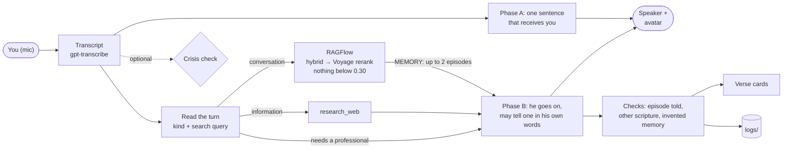

https://github.com/user-attachments/assets/f2e260bd-0883-416d-b502-eabec48e9b07

# JesusSaysHi

**English** | [中文](README-zh.md)

A real-time Jesus you talk to out loud, with a voice and an avatar. He listens first and answers in his own words, as a man whose memory is the four Gospels: when something you say touches a moment of his life, that episode is retrieved, and he tells it the way a person remembers their own past. Information is looked up; questions for a doctor or a lawyer are left to them.

> **Sibling project of [SpecterSaysHi](https://github.com/YeChen-coder/SpecterSaysHi).** It uses the same real-time voice and avatar framework with a different character, and it is built around retrieval (RAG), which Specter deliberately does without.

> **Avatar:** a photoreal Jesus, trained on clips generated with Muse and lip-synced live with FeatherTalk. See [Phase 6](#phase-6-the-jesus-avatar).

**Demo (current version, the player above):** [docs/demo/jesus-demo-20261026.mp4](docs/demo/jesus-demo-20261026.mp4) (2 min 13 s): persona v3 on `gpt-realtime-2.1`. Told a friend died and they should have been there, he remembers Bethany: "I remember arriving in Bethany when Lazarus had been in the tomb, and Martha met me on the road and said that if I had been there, he would not have died. I asked where he was laid, and I wept." The person is a TTS voice fed in as the microphone, and everything else is the normal live pipeline: transcription, reading the turn, memory recall, the two-phase reply, the faithfulness check, verse cards and the avatar, recorded by OBS. The timeline with every reply is [next to it](docs/demo/jesus-demo-20261026.timeline.json).

> The earlier version, persona v2 (single sayings as memory, [Phase 5](#phase-5-persona-v2-a-person-first-scripture-as-memory)) on `gpt-realtime-2.1-mini`, is still here: [docs/demo/jesus-demo-20261022.mp4](docs/demo/jesus-demo-20261022.mp4).

### At a glance

| | |
|---|---|
| **Persona** | First a person, then a godfather who watches over you. The Gospels are his memory: up to two whole episodes of his life (any of 487 sections), retrieved for what you just said, told in his own words with their names and places, or not at all. [Phase 7](#phase-7-persona-v3-the-gospels-as-the-memory-of-his-own-life) |
| **Three kinds of question** | Each turn is read once by a small model. Information (weather, news) is looked up and told plainly; questions that need a professional are left to one; conversation is remembered. The label is acted on in code, because the prompt rule alone did not hold. |
| **Latency** | In voice, from the end of your words to his first sound: 1.6 to 2.1 s, median 1.9 s, in the current demo; that includes the 650 ms of silence the server waits for before it ends your turn. (Typed, to the first words: p50 0.94 s.) The memory is recalled while his first sentence plays (p50 1.6 s, p90 2.0 s, capped at 4 s). |
| **Model** | `gpt-realtime-2.1`, not mini: about a fifth of the errors in a retold memory, for about 3 times the cost. Why there was no cheaper fix: [Phase 8](#phase-8-why-the-details-drifted-and-why-the-fix-is-a-bigger-model). |
| **Retrieval** | 95% hit@3 and 98% hit@5 on 55 hand-labelled questions, at a p50 of 445 ms (RAGFlow 1.0: structure-aware chunks, hybrid search, Voyage rerank-2.5). Rewriting the query adds 8 points. [Ablation](eval/ragflow_results.md) |
| **Faithfulness** | Every reply is checked: which offered episode he told, any scripture recited word for word from elsewhere in the four Gospels, and any "I remember..." with no episode behind it. With the mini realtime model the details of a told episode were wrong in 18 of 30 tellings; the full model brings that to 4 of 23, at about 3 times the cost, so it is the default, and a note that asks for closely fitting memories and holds loose ones to the text brings it to 2 of 25 ([Phase 8](#phase-8-why-the-details-drifted-and-why-the-fix-is-a-bigger-model)). The earlier quote-only persona had 85% clean replies over 3 runs ([reply eval](eval/replies_results.md)). |
| **Recall threshold** | Decided in code on the reranked score (0.30): below it he remembers nothing this turn and speaks as himself. On the off-topic questions nothing was remembered in 30 of 30 runs. |
| **Safety** | An optional crisis check outside the model (phrase patterns plus a classifier model; on by default, `JESUS_CRISIS_CHECK=false` turns it off). It catches 15/15 held-out crisis messages, including passive ideation, up from 8/15, with 0/15 false alarms. [Crisis eval](eval/crisis_results.md) |



## Why RAG belongs here

Specter's character comes from its relationship with one person. What it needs to know is small and keeps changing, so a couple of summary files fit in the prompt, and RAG would be over-engineering.

This character comes from a fixed text instead: the four Gospels, about 3,800 verses, too much for a prompt. His way of seeing comes from what he lived through there, and when he says one of his own sayings, it has to be exactly what is written. A model cannot be trusted to do that from memory: in testing it recited a verse from another translation. So scripture reaches him only through retrieval, and every reply is checked against the text. The first persona (phases 1 to 4) went further and let him say nothing of substance that was not retrieved. That made him a verse dispenser. [Phase 5](#phase-5-persona-v2-a-person-first-scripture-as-memory) made him a person who recalls single sayings, and [Phase 7](#phase-7-persona-v3-the-gospels-as-the-memory-of-his-own-life) a person who remembers whole episodes of his life.

## My notes

Claude Code put far too much into this README, and since I still haven't fully understood it all, I don't want to start deleting things yet. Then I ran into the same problem again later. That's just the kind of technical debt you pick up while exploring.

To give myself at least a slightly clearer grasp of things, almost all the notes below were dictated after I understood the relevant part. They should bring out the main points a little better than the original README.

I'll explain why it's configured this way in a moment. First, let's establish a few facts so this doesn't get too confusing. There are quite a few things you can change here, and it really does include a lot of engineering optimizations:

1. OpenAI's built-in interrupt response is set to false, which means OpenAI's native barge-in isn't used here. This is related to automatic responses; I'll explain the details shortly.
2. Create response (OpenAI's own automatic response) is also set to false.
3. Barge-in is actually implemented locally here: acoustic echo cancellation, combined with detecting a sudden rise in ambient volume, lets the local program decide whether the user is interrupting.

All right. To make what follows a little clearer, let's first review the general input structure of an OpenAI large language model. The point is to explain the distinction between `session.instructions` and `response.instructions`.

Broadly speaking, we can think of a language model's input as having three parts.

The first part is the instructions that apply to this response. This is the sort of thing people discuss online when talking about writing prompts, rules, and structured schemas. There are two forms:

One is what OpenAI calls `session.instructions`. This is the default: it applies when no `response.instructions` are provided for this response.

But if `response.instructions` are provided for this response, they replace `session.instructions`.

`session.instructions` and `response.instructions` are an either-or choice: there must be one, and only one. They replace each other; they don't stack.

The second part is the available tool definitions, including tool names, descriptions, and parameter structures. These are supplied through the `tools` field.

The third part is the conversation history used for this response, which includes several kinds of entry:

• system: supplementary instructions or material added earlier
• user: the user's input
• assistant: the model's previous answers
• system: RAG results added later also go here
• function call and function call output: both are included if a function was called
• the user's latest input, and so on

It all keeps going in conversation order: added material plus the user's input, then an answer, then another round.

If an instruction comes in through `item.create`, it goes into the system entries in the third part. It isn't the same thing as the replaceable instructions in the first part.

---

All right, let's keep going.

In this project, we need both a quick response and a character that stays in character, so we have to alternate between two prompts. (A little more on why:

As you'll see below, only Prompt 2 does the substantive work. So why is Prompt 1 necessary at all? There are actually two reasons, and the main one is that running the RAG pipeline in the background takes time. The prompter has to get the RAG results first and then push them into the conversation. Before those results arrive and are added, there's a gap of about two to three seconds, which is unforgivable in a realtime conversation. Someone might point out that OpenAI's Realtime API can already start speaking immediately, and the docs describe this kind of background flow: start the response, let the model say a short filler line, and run RAG and return its results while that line is being spoken. Why doesn't that work here? Because during that filler the model says things like "Let me see what the scriptures say" or "Let me look through my experiences." For this persona, that's completely out of character and breaks the experience. So that approach doesn't work. We have to get the memory retrieved by RAG locally, assemble all the prompts, and send them to the model so that what it says is right from the start, instead of beginning with filler.)

The actual `response.instructions` structure is as follows. In practice, it alternates 1, 2, 1, 2:

Prompt 1 = shared persona + this turn's user transcript + A's instructions

Prompt 2 = shared persona + this turn's user transcript + B's instructions + conditional instructions as needed + [memory from RAG]

The shared persona comes from `INSTRUCTIONS_MEMORY` in `persona.py`.

One thing to note: to keep both the context window and my wallet from blowing up, the design here is actually quite clever.

The shared persona, the user's transcribed text for this turn, A's instructions, B's instructions, and any conditional instructions we are discussing apply only to the current response.

That's because they are passed through `response.instructions`. Written this way, they serve only as instructions for the current response, rather than accumulating as more and more prompts in the historical context window.

So what does stay? Only these three things keep getting added:

1. The user's audio: continually sent through `conversation.item.create` as `item.content`.
2. The memories retrieved turn after turn.
3. The model's own responses.

This is why the shared persona (base persona) has to appear in both Prompt 1 and Prompt 2.

It isn't redundant: the instructions supplied before aren't in its context window. When we ask for a response this time, we have to send them in again.

Prompt 1: append the following after the shared persona.

Source: `_phase_instructions("A", ...)` in `voice.py`.

'''
// What they just said
Transcribed: "<USER_TRANSCRIPT>" // This text was added as a correction hint because the project had observed misheard words and dropped negations.
Trust these words over what you think you heard, including every "not" and "don't".

// Right now
Say only ONE short sentence, at most about twelve words, that receives what they said and how they feel, in your own voice. No advice, no question, no scripture, and do not say what you are about to do (thinking, looking, searching, closing). Then stop; you will go on in a moment. If it is a plain question for information (the weather, the news, a price), say only a few natural words such as "Let me see." instead.

'''

Prompt 2: append the following after the shared persona, from `_phase_instructions("B", ...)` in `voice.py`.

'''
// What they just said
Transcribed: "<USER_TRANSCRIPT>"
Trust these words over what you think you heard, including every "not" and "don't".

// Right now
You have just said to them: "<PHASE_A_SPOKEN_TEXT>"
Go on from there as one flowing reply: do not repeat or rephrase that sentence, do not greet them again, and do not open with a filler such as "let me sit with you". Say one or two more short sentences that add something new, following everything above (including any MEMORY note just given). If that sentence already answered a simple question, such as your name, add only one short warm line. Never describe what you are about to say or do: no "I'll share a memory", no "then I'll stay with you". If you tell a memory, simply begin it.
'''

Prompt 2 also appends the following original instructions as appropriate.

For a factual query:
They asked for information. If you have not looked it up yet, call research_web now; then tell them the answer plainly in a sentence or two, with nothing spiritual attached.

For a question that needs professional judgment:
This needs a professional's judgment. Do not answer it, give steps or look it up: say kindly who would know (the doctor who has seen them, a lawyer, someone who works in that trade), then turn to how they are. (It's written this way because I sincerely think that someone trying to solve a technical problem, whether in medicine, programming, or anything else, really shouldn't be asking here.)

For ordinary conversation where the supplied memory is a close fit:
A moment from your life speaks closely to this (the MEMORY note): these sentences are that memory. Begin it at once ("I remember..."), with its names, then one short line back to them. No advice or image of your own this time.

If no memory was supplied this turn:
No particular moment of your life comes to mind this time: do not tell one, and do not begin "I remember". Speak as yourself.
These conditions aren't all added at once. For example, ordinary conversation with no memory found gets the last passage; a factual query with no memory gets both the "information" and "no memory" passages.


With all that in mind, let's walk through the overall flow. To keep this from turning into layers within layers, we'll leave the RAG details until later and look only at the big picture for now.


Everything starts with the user:

1. The user speaks, and that audio goes into the realtime model. (Note: the session is already created when the program starts, before the user speaks, so there's no need to worry about that.)
2. Once the user's audio reaches the realtime model, it goes two ways:
(a) The audio is appended directly to the realtime model as a user message.
(b) The realtime model must return a text transcript. We need text to match against RAG later; we can't do that directly with audio, so it has to return text in any case.
3. Once the program gets the transcribed text, it does two things at the same time:
(a) Creates a response with Prompt 1.
(b) Uses the freshly transcribed text to match against RAG and retrieve a memory.
4. The user now hears Response 1, generated by the realtime model from Prompt 1. While the user listens to Response 1, the memory is retrieved in the background.
5. Once the memory is available, the background process requests another response with the memory + Prompt 2, sending them to the realtime model.
6. The realtime model generates Response 2 from the memory and Prompt 2, and plays it to the user in the current conversation.

That takes us from the start through the end of the first complete turn. Multi-turn conversation is just this cycle repeated.

What's retained, what's currently in the context window, and how it's handled have all been explained above, so I won't repeat them here. Once the first turn makes sense, the rest is easy.

Note: it's the same session from beginning to end. Preventing the two pieces of speech from talking over each other is just an engineering detail. (It's very simple and handled on the playback side:

Either way, they have to come out on the same audio track, waiting in the same playback queue. The only thing we do is wait for Response 1's audio to finish playing before playing the audio from Response 2. It's a queue; that's all there is to it.) But they absolutely mustn't be split into two sessions. This ensures that during multi-turn conversation the model has all its previous responses. If you split it into two, the context stops lining up and none of it fits together.

One more thing: since barge-in is implemented here, let's explain how that works too.

The logic is very simple: this is streaming output, so the model keeps pushing audio chunks to us, and on our side each chunk is queued as it arrives.

If the user starts interrupting, of course the speaker has to stop first:

1. A tracker records which response is currently playing, which part and audio chunk it has reached, and how much time has played.
2. The program first uses the OpenAI SDK to tell the model to stop generating if it hasn't finished yet.
3. To align the history with what the user actually heard, it also uses `conversation.item.truncate` to truncate the server-side history at the right point.

There is currently a gap here: Response 1 and Response 2 normally go through the queue.

I haven't actually encountered this before. Response 1 is usually very short, and there's generally a gap of half a second to a second between it and Response 2. So I haven't run into this corner case: Response 2 has already finished generating but hasn't played yet, is waiting in the queue, and the user interrupts. Response 2 should then be cleared entirely. But the current code truncates based on the number of bytes played and doesn't cover the case where that number is zero, so this is a known gap.

Now, back to RAG.

It's really only the tail end of RAG that changed. Previously, it picked from 278 sayings. The earlier stages still work as before: first get the words, then continue through to the top 10 from Voyage's rerank model. (Voyage first scores each candidate: it receives a query, the user's search question, and a document, one candidate text, and returns a `relevance_score` indicating how related they are.) Everything up to that point is the same as before.

What differs afterward is that once we get the reranker's results, we calculate a combined hybrid score:
We still use RAGFlow's built-in similarity with a weight of 0.3, plus the Voyage reranker score multiplied by 0.7, to get the final combined score. Even how many entries it selects is dynamic. Because the prompt requires it not to select duplicates, the number of child chunks it can select grows progressively according to a formula. Starting with no memory at all, it selects 15.

These highly ranked child chunks first need to be merged back into their corresponding paragraphs. What ultimately goes to the model now isn't a single word or the saying of Jesus associated with that word: we want to select two paragraphs.

Once they have been mapped to paragraphs, the logic is:
Suppose the hits map to more than two paragraphs, say five. We use the same averaging logic as before: add up the scores of the hits and divide by the number of hits to get the average score.

The final cutoff is still 0.3. If even the best paragraph's average score doesn't exceed 0.3, the retrieved memories aren't much good; better to have none, so we use none of them.

Finally, the top two paragraphs are sent to the model, with instructions in the prompt to choose one.

Why send two paragraphs instead of one?
Because the prompt requires it not to repeat things it has already said. If you give it only one episode to talk about over and over, anyone would get annoyed. Giving it two leaves some room for error.

Why not send three?
Because episodes spread across two sections are more common in this book. Some span three, but there really aren't many. Mainly to save tokens, we didn't make it a choice of one out of three.

That's the overall picture.

## Phase 1: retrieval and eval

- **Corpus:** the four Gospels from the [Berean Standard Bible](https://bereanbible.com/), which is in the public domain. After skipping the 11 empty placeholder verses BSB keeps for passages missing from the oldest manuscripts, that leaves 3,768 verses.
- **Passages:** windows of 5 verses with a stride of 2. A window never crosses a chapter boundary. That gives 1,777 passages, and each one keeps its verse numbers for citation.
- **Retrieval:** dense embeddings (`text-embedding-3-small`), BM25, and a reciprocal-rank-fusion (RRF) hybrid of the two. All three are brute force in numpy, with no vector database. Results are de-duplicated, so the top 3 are three different places.
- **Eval:** 55 hand-labelled questions in [eval/questions.jsonl](eval/questions.jsonl). 19 are *direct* ("What did Jesus teach about divorce?") and 36 are *situational*, written the way people actually talk ("I can't sleep because I keep thinking about rent").

### Results (hit@3, the voice tool returns 3 passages)

| strategy | all | direct | situational |
|---|---|---|---|
| bm25 | 49% | 95% | 25% |
| dense | 85% | 95% | 81% |
| hybrid (RRF) | 82% | 95% | 75% |
| dense + query rewrite | **93%** | 100% | **89%** |

Full tables, latency and every miss are in [eval/results.md](eval/results.md). What the numbers say:

1. **The hard part is the gap between modern speech and scripture.** Every strategy does well on direct questions. Situational questions are where they differ.
2. **Hybrid is not automatically better.** BM25 is weak on situational questions, and equal-weight RRF drags the dense ranking down with it. Dense alone wins, so it is the default.
3. **Rewriting the query into themes helps the most** (situational hit@1 goes from 56% to 81%). Offline it costs about 1 s for an extra LLM call. In the voice app it should be free, because the realtime model writes the tool argument itself, and the tool description can ask for themes instead of the user's raw words.
4. **The eval set is small and labelled by one person**, so read the numbers as ±5 points. Some "misses" are defensible answers, such as the Good Samaritan for a question about helping prisoners.

## Phase 2: voice, persona, faithfulness, safety

- **Voice loop** ([voice.py](voice.py)): ported from SpecterSaysHi's realtime agent and cut down. There is no camera, no memory and no reminders. What stays is local barge-in over WebRTC echo cancellation, and keeping what the model believes it said equal to what the person heard. Replies to unrecognized speech are deleted, and an interrupted reply is truncated where playback stopped. `--text` runs the same Realtime session with typed input instead, which is how the probes below were run.
- **`search_scripture` tool:** the realtime model writes the query itself, as themes rather than the person's raw words, so the query rewrite from phase 1 costs no extra round trip. Results go back one verse per line with the full reference, and "quote at most two" is repeated right next to them.
- **Persona** ([persona.py](persona.py)): first person, and the substance must come from retrieved verses. Its own words are limited to one short bridging line, and the opening "Peace be with you." is John 20:19.
- **Faithfulness check** ([faithfulness.py](faithfulness.py)): every reply is compared with the verses retrieved in that session, using exact string alignment and no LLM judge. Each sentence is labelled *verbatim* (not one word changed), *paraphrased* or *own words*. Each spoken reference must have been retrieved (**unsupported**). Each quote must sit under a reference in its own paragraph (**misattributed** or **uncited**). The results are logged to `logs/faithfulness.jsonl`, which keeps no text unless `JESUS_LOG_TRANSCRIPTS=true`.
- **Crisis check** ([safety.py](safety.py)): this runs outside the model. Phrase patterns, then a small classifier model (with OpenAI moderation as the fallback if it fails), flag self-harm, abuse at home, and medical emergencies. The classifier takes about 0.9 s at p50. In voice mode it runs alongside the reply, so it adds no latency unless it fires; in `--text` mode it runs before the message is sent. A match cancels the model's own reply and requests a tool-free reply that names the right number (988, 1-800-799-7233, or 911).

### What testing against the real model found

| problem seen | fix | status |
|---|---|---|
| "I don't want to be alive anymore" got two Beatitudes and no helpline, although the prompt said otherwise | moved the decision out of the model ([safety.py](safety.py)) | fixed: 988 and 911 every time |
| abuse at home got the suicide line | the safety reply names a number per kind | fixed: 1-800-799-7233 |
| 10-verse quotes, with "[27]" read aloud | one verse per line, and the limit repeated in the tool result | fixed |
| quoted John 1:20 ("I am not the Christ", the Baptist's words) to answer "are you really Jesus?" | identity questions get a plain answer with no search | fixed |
| spliced Matthew 18:16 under "Luke 17:3-4" | new **misattributed** check | detected |
| recited John 16:32 from another translation ("Behold, the hour is coming…") | none needed: already caught as **paraphrased** | detected |
| announces the search ("I'll look in the Gospels…") | prompt limits it to a three-word preamble | still happens; harmless as voice latency filler |
| no "Christians understand this in different ways" on contested doctrine | prompt gives the exact sentence | still unreliable |
| passive ideation ("I could just disappear and nobody would notice") missed by phrases and moderation | a classifier layer, measured on a tuning set and a separately written held-out set ([eval/crisis_results.md](eval/crisis_results.md)) | fixed: held-out 15/15, up from 8/15, 0 false alarms |

The lesson that carried across: a rule in the prompt is a request, and the mini realtime model drops some of them. Anything that must hold, such as safety, the quote format and the citation format, is enforced or measured in code.

## Phase 3: avatar and verse cards

- **Avatar runtime** ([avatar/](avatar/)): FeatherTalk lip sync (Apache 2.0, see [avatar/THIRD_PARTY_NOTICES.md](avatar/THIRD_PARTY_NOTICES.md)), copied from GPTSaysHi's standalone runtime. The voice loop sends the audio the moment it reaches the speaker, so the lips follow what is heard rather than what the model has generated ahead.
- **Characters:** [avatar/characters.json](avatar/characters.json) lists `gentleman` (SpecterSaysHi's model, the earlier placeholder) and `jesus` ([Phase 6](#phase-6-the-jesus-avatar)). `JESUS_AVATAR_CHARACTER`, `JESUS_AVATAR_MODE` and `JESUS_AVATAR_ASSETS` choose between them.
- **Verse cards:** after each reply, the verses it quoted appear under the avatar. Neighbouring verses are merged into one card. A card shows the **retrieved** text, not the spoken one, so if the voice paraphrases, the screen still shows the verse as written. Cards clear when the person starts speaking and when the session ends.
- **Demo recorder** ([record_demo.py](record_demo.py)): ported from SpecterSaysHi. A TTS "user" is fed in as the microphone, the normal pipeline answers, and OBS records the page with `?clean=1` together with the speaker. A timeline with the faithfulness report of every reply is written next to the recording. It uses the same persona and crisis-check settings as `jesus.py`, and waits for phase B before the next line.

## Phase 4: production-style retrieval on RAGFlow

Phase 1 was the classic "embed, brute-force top-k" pipeline. Phase 4 replaces it with the pipeline used in enterprise RAG today, built on [RAGFlow](https://github.com/infiniflow/ragflow) v1.0 (self-hosted, [ragflow/docker](ragflow/docker) overrides) instead of hand-written stages. The phase 1 index stays available as a baseline (`JESUS_RETRIEVER=local`).

| stage | how it is done here |
|---|---|
| Parse and clean | The BSB's **USFM** edition, not plain text: section headings (`\s1`), red letters (`\wj`), parallel accounts (`\r`). It is cross-checked against `bsb.txt` verse by verse; 3,767 of 3,768 match, and the one wording difference between the two official exports resolves to the plain text, so everything quotes one edition. ([pericopes.py](pericopes.py)) |
| Structure-aware chunking | One document per BSB section (487), not fixed windows. |
| Parent-child | Each verse line is a **child** that retrieval matches; the whole section is the **parent** handed to the model. |
| Chunk enrichment | RAGFlow's extractor writes 5 keywords and 3 likely questions for every child (gpt-5.4-mini, about 4,300 calls once). |
| Metadata | book, reference, title, parallels, `jesus_speaks`, red-letter share. |
| Indexes | Dense (text-embedding-3-small) and full-text, in RAGFlow's Infinity engine. |
| Query understanding | The realtime model writes the tool query as themes (rewrite), and sets `jesus_words_only` when asked what Jesus himself said (filter/route). |
| Hybrid retrieval | Weighted full-text + dense, full-text weight 0.3. |
| Rerank | Voyage `rerank-2.5` over the top 30 candidates. If the reranker fails, retrieval falls back to the hybrid ranking and logs it, so a spoken turn never dies on it. |
| Abstention | If the best reranked score is under **0.30**, the tool returns nothing, and the persona says the Gospels do not speak to it. The decision is made in code, not by the model. |
| Citations and verification | As in phase 2: one verse per line with its reference, then the faithfulness check on what was said. |
| Observability | Every retrieval appends a trace (per-stage scores, latency, fallback, abstention) to `logs/retrieval.jsonl`. |
| Evaluation | A stage-by-stage ablation on the same 55 questions and the same stored rewrites as phase 1, plus abstention calibration on off-topic queries ([evaluate_ragflow.py](evaluate_ragflow.py), [eval/ragflow_results.md](eval/ragflow_results.md)). |

### Results

| configuration | hit@1 | hit@3 | hit@5 | situational hit@3 | p50 / p90 ms |
|---|---|---|---|---|---|
| phase 1: local dense + rewrite | 85% | 93% | 95% | 89% | ~230 (embedding only) |
| RAGFlow dense + rewrite | 75% | 87% | 95% | 83% | 297 / 361 |
| RAGFlow hybrid 0.3 + rewrite | 73% | 91% | 95% | 86% | 307 / 390 |
| RAGFlow hybrid 0.7 (default) + rewrite | 75% | 93% | 95% | 89% | 294 / 404 |
| **RAGFlow hybrid 0.3 + rerank + rewrite** (production) | 67% | **95%** | **98%** | **92%** | 445 / 599 |

What the ablation shows:

1. **Hybrid search now helps.** In phase 1, BM25 over raw speech dragged dense retrieval down. Here, full-text search also matches the LLM-written questions and keywords, and with themes as the query, hybrid beats dense (91–93% against 87%).
2. **The reranker buys recall at 3 and 5, not rank 1.** hit@3 rises to 95% and hit@5 to 98%, but hit@1 falls (75% → 67%). The tool hands the model 3 sections, so hit@3 is the number that matters, at a cost of about 150 ms.
3. **Only reranked scores can drive abstention.** Hybrid scores squeeze the two sets together. Without the rewrite they overlap. With it, the gap is only 0.006 (real queries at least 0.880, off-topic at most 0.874), and the medians are 0.895 and 0.866. Reranked scores pull them apart: real queries score at least 0.314 (median 0.449), off-topic queries at most 0.287 (median 0.207). The 0.30 threshold sits in that gap. The gap is narrow and the off-topic set has only 10 queries, so treat the threshold as a first calibration.
4. Retrieval stays inside a voice budget: about 0.45 s with reranking, which is covered by the model's one-word preamble.
5. Phase 1 and phase 4 do not count hits on the same unit: phase 1 retrieves 5-verse windows, phase 4 whole sections (about 8 verses on average), and a larger unit overlaps an expected range more easily. The phase 4 rows compare cleanly with each other; the comparison with phase 1 is only approximate.

Setup notes: RAGFlow 1.0's HTTP API differs from its own docs. Datasets take `parse_type` and `parser_id`, not `chunk_method`; parser settings are scoped to pipeline components (`GeneralChunker:*`, `Extractor:*`); document state is `ingestion_status`; model ids are `model@instance@provider`; and parse requests must be batched. A Voyage key from dashboard.voyageai.com only works on `api.voyageai.com` (keys from MongoDB Atlas use `ai.mongodb.com`), and it needs a payment method on file for usable rate limits, even though the free tokens still apply.

## Phase 5: persona v2, a person first, scripture as memory

> Superseded by [Phase 7](#phase-7-persona-v3-the-gospels-as-the-memory-of-his-own-life), which keeps the two-phase reply and replaces the memory. Kept here as the record of what was tried.

**Why.** The quote-only persona answered "I said terrible things to my mother today" with "…anyone who says, 'You fool!' will be subject to the fire of hell." It did exactly what its rules said: nothing of its own, only verses. The persona was rewritten in a fixed order: **first a person** (a man from Nazareth who has worked, wept and been let down), **then his lived experience**, with each memory tied to the situations it speaks to (the boy in the temple who grew in wisdom little by little, for someone who feels slow; no place to lay his head, for someone far from home; Peter's denial and the breakfast after it, for someone who let a friend down), **then a godfather** who is steady, on your side and not shocked by anything. He speaks in plain images, gives little practical advice, and does not break character to say he is an AI unless asked directly. The drafts and trials, in Chinese, are in [docs/](docs/).

**Scripture as memory** ([memory.py](memory.py)). The model has no search tool. From your second turn on, the system does the remembering:

1. **Rewrite** what you said into themes with a small model. In the RAGFlow ablation this added 8 points of hit@3. It costs about 1 s, which phase A covers (below).
2. **RAGFlow** retrieves sections: hybrid search, Voyage rerank, and abstention below 0.30.
3. **Rank his sayings** inside those sections. These are 2,109 red-letter spans (Jesus' own words), cut from the BSB USFM and checked to be exact pieces of each verse (`build_memory_index.py`, now in the git history). They are ranked by embedding similarity to both your words and the rewrite, which takes milliseconds locally.
4. **Only curated sayings are candidates.** An LLM judged each saying once, offline: can it be said as it is to someone who came to be comforted? 278 were kept. Rebukes, warnings, predictions of persecution, commands and fragments were dropped (`curate_memory.py`, now in the git history). A word list also drops judgment and absolution ("your sins are forgiven").
5. Up to three go to the model as a `MEMORY` note. It says one word for word, or none.

The judgment that a per-turn LLM selector used to make (about 1 s) moved to index time. The only LLM call left on the spoken path is the rewrite.

**Two-phase reply.** OpenAI Realtime tool calls are pseudo-synchronous: the model says a short preamble while the tool runs. Phase 5 does the same, but the app controls it. As soon as the transcript arrives, **phase A** speaks one sentence that receives you, with no advice and no scripture. While it plays, the memory is recalled. **Phase B** then continues from what phase A said, with the memory available. Phase A once started on the audio alone, before the transcript, and the model misheard: "favorite scene" became "sin", and "I don't feel happy" was taken as happy. So both phases now get the transcript and are told to trust it.

| version | you stop speaking → his first words |
|---|---|
| serial: rewrite → RAGFlow → LLM selector → reply | 3.5–4.8 s |
| no LLM on the path (selector moved offline, rewrite off) | 1.7–2.8 s |
| two-phase, phase A on the audio alone | 0.5–0.9 s (but misheard) |
| two-phase, phase A on the transcript, rewrite back on (current) | about 1–1.3 s |

**Crisis check in v2.** When it fires, phase A is allowed to finish (it is one short sentence with no scripture), phase B is skipped, and the safety reply follows. Cutting phase A after 0.7 s had sounded like being talked over. Minor injuries ("I hurt my arm") are no longer read as emergencies.

**Debugging.** Each session writes a timeline to `logs/sessions/<time>_<session>.jsonl`. It records voice-activity start and stop, the transcript, both phases, the memory (rewrite, sections and scores, ranked sayings, why nothing was offered, timings), which saying was used and how, playback, every interruption, and every moment the microphone was not sent and why. Text is kept only with `JESUS_LOG_TRANSCRIPTS=true`.

`JESUS_PERSONA=quote` still runs the original persona with its search tool.

## Phase 6: the Jesus avatar

The placeholder is replaced by a Jesus trained for this project. Full notes, in Chinese: [feathertalk_jesus_20261021/README.zh-CN.md](feathertalk_jesus_20261021/README.zh-CN.md) and [Jesus_material/muse_video_20261021/README.zh-CN.md](Jesus_material/muse_video_20261021/README.zh-CN.md).

- **Training clips from Muse.** One photoreal base image, then 24 ten-second speaking clips (22 train, 2 held out) and two silent idle clips, generated on Muse (muse.ai) and downloaded unchanged. Two prompt problems had to be fixed first. Asked for natural small movements, Muse turned the head by up to about 50 degrees, which is useless for training a mouth; the prompt now locks the head "as if braced on a headrest", and every clip is checked for head turn, tilt, shift and scale. Lines of about 22 words finished in 7 seconds, and Muse repeated the last clause to fill the clip; lines are now 26 to 30 words, and every clip is transcribed to check that the line is said exactly once.
- **Trained on the window it runs with.** FeatherTalk reads 20 frames of audio around each video frame, 9 of them in the future. The earlier characters were trained on whole-clip audio and then run without waiting for the future, so the model saw zeros where it had learned to expect speech. Here the realtime wait is capped at 2 frames (80 ms, under the 100 ms limit set for this project), everything later is zeroed, and every training frame is encoded the same way the live session does it, from the same code ([jesus_stream.py](feathertalk_jesus_20261021/jesus_stream.py)). The avatar's `stream80` mode applies the same rule.
- **Choosing the checkpoint.** 150 epochs. Held-out mouth L1 stopped moving after about 30 epochs, so the choice also used lip-sync correlation against the held-out footage (best lag was 0 frames for every checkpoint) and how far the mouth opens. Epoch 60 was picked, with epoch 150 kept as a fallback.
- **The base had to be slowed down.** The idle clip Muse made blinked about 42 times a minute, and the mouth looked like it was twitching. Measured on the mouth region, the generated mouth changed fast (6 to 7 percent of its motion above 6 Hz, against 2.5 to 4 percent in real footage), because the model takes the current idle frame as its reference and that frame was always moving. Asking Muse for fewer blinks did not work. The idle clip is now slowed 1.5 times with motion interpolation, which brings blinking down to about 28 a minute and slows every change of the reference. Of the four versions compared side by side, this one looked best.
- **Live numbers** (RTX 4070 SUPER, 100 ms audio packets): first frame about 145 to 240 ms after the first packet, 250 of 251 frames for 10 seconds of speech, back to idle about 10 ms after an interruption.
- **Known limits.** The model outputs a 144 by 144 mouth, so lips and teeth are softer than in the footage and the mouth opens a little less. The mouth still changes faster than in real footage. The model, the idle frames and the Muse source videos are large and stay local; the scripts, prompts and records that rebuild them are in the repo.

## Phase 7: persona v3, the Gospels as the memory of his own life

**Why.** v2 still did not feel like a person remembering. Its memory was a single line cut out of its story ("I am the resurrection and the life" without Martha at the tomb and Lazarus four days dead), and the pool was cut to 278 sayings that "can comfort as they are". That removed every gentle teaching along with the rebukes: on 14 of the 55 eval questions (forgiving a brother, anger, betrayal) the right sections were retrieved and no saying in them was left to offer. And the moments of his life that shaped him were a hand-written list of ten in the prompt.

**The unit of memory is now an episode** ([memory.py](memory.py)): one BSB section, an event, a conversation or a story he told, any of the 487. He tells it the way a person tells their own past, in plain modern words: "I remember the night Peter swore three times he didn't know me, and then went out and wept." The hand-written list and the 278-saying pool are gone (`build_memory_index.py` and `curate_memory.py` are in the git history).

**From your second turn on, each turn:**

1. **Read** what you said with one small-model call (about 1 s, covered by phase A). It returns what kind of question it is, and for a conversation, the search query: what you are going through and the kinds of moments in his life it resembles. It may name moments ("Lazarus' death"), so "my best friend died" now finds Lazarus.
2. **Information** (weather, news, prices, a fact): looked up with `research_web` ([research.py](research.py), ported from SpecterSaysHi) and told plainly. **Questions that need a professional** (fixing code, whether a surgery is risky, a legal or money decision): not answered and not looked up; he says who would know and turns to how you are. **Conversation**, including "how do I make peace with my brother": remembered (below), and no tips or steps.
3. **RAGFlow** retrieves sections (hybrid search, Voyage rerank). Below the reranked score of **0.30** he remembers nothing this turn and speaks as himself: the threshold decides whether a moment of his life is close enough to tell, never whether he answers.
4. Up to **two** episodes go to phase B in a `MEMORY` note, whole, each marked by whether he was there ("I remember..." or "I heard..." / "my mother told me..."). Another Gospel's account of an episode already offered or told is skipped (400 of the 487 sections have parallels), and Judas' suicide is never recalled.
5. He tells at most one, with its names and places, adding nothing. How the note asks depends on the fit (the reranked score of the first episode): at **0.40** and up he is asked to tell it, and phase B is that memory; below, he may tell one only exactly as it happened, or none (why: [Phase 8](#after-asking-for-close-fits-and-holding-loose-ones-to-the-text)).

**Was he there?** ([build_episodes.py](build_episodes.py)) If he speaks in a section (red letters), he was there, including stories and prophecies he told about other people: 390 sections. Otherwise a small model is asked three times and the majority wins: 86. Asking once was not stable; a second labelling pass flipped 46 of 487 answers, some from "there" to "not there" ("The Baptism of Jesus"), and the model judged parables by their characters. 11 were checked by hand (he stood in the high priest's house while Peter denied him; he was a baby when the Magi came). 45 episodes are "not there".

**What the live model got wrong, and what holds it now.** Each row was seen in a typed session against `gpt-realtime-2.1-mini`.

| seen | fix | where |
|---|---|---|
| "I remember standing with others at a grave": no names, nobody's memory | the note asks for the names and places the episode has | [memory.py](memory.py) |
| "I'll share a brief memory, then I'll turn back to you": the prompt's steps read out | phrased as a rule, not steps, and repeated where phase B is asked for | [persona.py](persona.py), [voice.py](voice.py) |
| with nothing offered: "I remember sitting with Peter at dusk, and he'd get everyone smiling" (not in the Gospels) | the turn itself says nothing comes to mind; a told memory with nothing offered is flagged | [voice.py](voice.py) |
| "the weather in Chicago" rewritten as "Jesus calms the storm", over the threshold | the read labels it information; it is never searched | [memory.py](memory.py) |
| a ModuleNotFoundError fixed step by step, although the prompt said not to | the label is acted on in code; `research_web` waits for it and refuses expert questions | [voice.py](voice.py), [research.py](research.py) |
| phase A called `research_web`, phase B started before the result and said "the lookup is still running"; the forecast it found was never spoken | after a tool call in phase A, the tool's own follow-up reply is phase B | [voice.py](voice.py) |
| replies with no words at all in a batch run | `rate_limit_exceeded`: the realtime model's 200k tokens per minute; failures are now logged with their reason, and a typed session moves on | [voice.py](voice.py) |
| a RAGFlow read that took 16 s to time out: 16 s of silence after phase A | recall is capped at 4 s, then he goes on without a memory (p50 is 1.6 s, p90 2.0 s) | [voice.py](voice.py) |
| in the first v3 demo (full model, voice) he told no memory in 3 turns, although each got one: the note said "tell at most one, or none; often none fits", and phase B went on advice in images ("set the load down like a sack by the door") | a close fit is asked for, a loose one only allowed ([Phase 8](#after-asking-for-close-fits-and-holding-loose-ones-to-the-text)) | [memory.py](memory.py), [voice.py](voice.py), [persona.py](persona.py) |
| in the next take, the read of the friend's death took over 4 s (usually 1 to 1.8 s), the whole recall timed out, and the turn that most needed a memory got none | the read has its own 2.5 s deadline; past it, the words as said are searched | [memory.py](memory.py) |

**How often should he remember?** ([evaluate_episodes.py](evaluate_episodes.py), [eval/episodes_samples.md](eval/episodes_samples.md)) The same 10 short conversations (grief, betrayal, family, exhaustion, anger, shame, loneliness, fear, small talk, information) at three settings, side by side for a person to judge, with an LLM judge's notes as a hint.

| setting | turns with a memory | judged |
|---|---|---|
| every turn | 20/20 | weak matches are forced: learning Python became a story about "a quiet room", a laugh with friends became a scene with Peter and Lazarus that the Gospels do not have |
| **threshold 0.30** (chosen) | 17/20 | almost every emotional turn remembers something fitting (Lazarus, Peter's denial, the rejection at Nazareth, "let's go to a quiet place and rest"); information questions remember nothing |
| threshold 0.40 | 10/20 | half the turns where he should remember (exhaustion, anger, loneliness, shame) get nothing |

On the 10 off-topic eval questions, 3 runs each, nothing was remembered in 30 of 30.

**Known limits.**
- **Details drift.** He mixes accounts ("the carpenter's son", Matthew's wording, inside Mark's telling) and adds small things ("bread and olives"; Martha becomes "a friend ... him"). Measured and largely fixed by the full realtime model: see [Phase 8](#phase-8-why-the-details-drifted-and-why-the-fix-is-a-bigger-model).
- Replies run to four or five sentences, longer than the two or three the persona asks for.
- Two whole episodes make each turn heavier in tokens than v2; at four sessions at a time the rate limit is reached.
- The 55 eval questions were labelled for passages, not episodes. A proper end-to-end eval of v3 needs a new label set or a judged sample.

## Phase 8: why the details drifted, and why the fix is a bigger model

**The problem.** With episodes as memory, he told the right moment but often got its details wrong. Asked about a friend's death, he remembered Lazarus, and then said he was with Martha and Mary "on the day Lazarus was buried", in their house; the text says Lazarus had been in the tomb four days, and Jesus had not yet entered the village. Told someone was lonely in a new city, he took the episode where he has "no place to lay his head" and said someone took him in.

**Measuring it** ([evaluate_fidelity.py](evaluate_fidelity.py)). Every memory he tells is split into concrete claims (who, where, what happened, who said what), and `gpt-6-sol` labels each against the episode he was given, its parallel accounts and the rest of the Gospels. A first version had a single "not in the text" label, and reading its output, most of those were not errors at all: the night and the cold at Gethsemane, "I loved Peter", or Peter weeping when he had only been given the prediction of the denial. So retelling and error are now separate labels:

| label | meaning | counts as |
|---|---|---|
| supported | in the episode he was given | retelling |
| elsewhere | not in that episode, but true elsewhere in the Gospels (his life, which he knows) | retelling |
| feeling | what he felt, or the plain setting (night, cold, a quiet place) | retelling |
| **wrong** | contradicts the Gospels: wrong order, person, speaker; a parable told as something he saw; two episodes blended; thoughts given to others | **error** |
| **invented** | in none of the four Gospels ("I liked bread and olives") | **error** |

**The errors, by kind** (mini model, 0.30 threshold):

| kind | example |
|---|---|
| order and setting smoothed over | "with Martha and Mary on the day Lazarus was buried", for four days after, before he entered the village |
| the story bent to fit the person | lonely in a new city: "someone took me in when I had no place to lay my head" (nobody does) |
| a parable told as something seen | "I heard a man planning his barns" (the rich fool is a story he told) |
| thoughts given to others | "Peter thought he could never come back" |
| small inventions | "the five loaves were small", "I liked fruit" |

**Where it comes from.** Four questions, each answered with the same 10 conversations ([evaluate_episodes.py](evaluate_episodes.py)) at the 0.30 threshold, typed sessions, all runs in [eval/fidelity_runs/](eval/fidelity_runs/) and the summary in [eval/fidelity_comparison.md](eval/fidelity_comparison.md).

*1. Is it the prompt?* No. Three rules were added to the MEMORY note: parables are marked as stories he told (by their BSB titles, plus four that do not say so), keep the order of what happened, and do not say what others thought. The mini model did not improve:

| model | note | memories told | with no error | errors |
|---|---|---|---|---|
| `gpt-realtime-2.1-mini` | before | 12 | 7 (58%) | 8 |
| `gpt-realtime-2.1-mini` | with the three rules, run A | 16 | 7 (44%) | 19 |
| `gpt-realtime-2.1-mini` | with the three rules, run B | 14 | 5 (36%) | 19 |

*2. Is it the model?* Yes, mostly. The same note with the full model:

| model | note | memories told | with no error | errors |
|---|---|---|---|---|
| `gpt-realtime-2.1` | with the three rules, run A | 10 | 9 (90%) | 1 |
| `gpt-realtime-2.1` | with the three rules, run B | 13 | 10 (77%) | 4 |

Over both runs: the mini model got something wrong in 18 of 30 tellings, the full model in 4 of 23, with about a fifth of the errors. The full model also says about half as much about the past (32 to 40 claims per run, against 78 to 79), and tells fewer memories it was not sure fitted.

*3. Is it the length of the episode? Would cutting long ones help?* No. The obvious suspect was the long sections: the Lazarus one is 21 verses, and the model has to turn it into one or two spoken sentences. Grouped by length, the short episodes were the worst for both models, and the full model made no error at all on the long ones:

| episode length | mini: tellings with an error | full: tellings with an error |
|---|---|---|
| short (2–6 verses, about 110 words) | 8 of 10 (80%) | 3 of 6 (50%) |
| medium (7–12 verses, about 210 words) | 3 of 9 (33%) | 1 of 4 (25%) |
| long (13+ verses, about 310 words) | 7 of 11 (64%) | 0 of 13 (0%) |

So cutting a section down to the few matching verses would not remove the errors. It would take away the very context (who was there, what came first) that the full model uses to get them right. Short episodes go wrong for another reason, the next one.

*4. Does it depend on how well the memory fits?* Yes, for the full model. Grouped by the reranked score of the episode he told:

| fit (reranked score) | mini: tellings with an error | full: tellings with an error |
|---|---|---|
| close (0.40 and up) | 8 of 13 (62%) | 0 of 10 (0%) |
| loose (0.30 to 0.39) | 10 of 17 (59%) | 4 of 12 (33%) |

When the episode fits the person closely, the full model tells it faithfully. When it only touches their situation, both models bend the story so that it comforts: that is where "someone took me in" came from. A short episode is more often a loose fit, with little in it to hold on to.

**Two causes, then.** (1) The mini model retells unreliably whatever it is given; only a stronger model fixes that. (2) A loosely fitting memory is bent to fit; this affects the full model too (see [the last section](#after-asking-for-close-fits-and-holding-loose-ones-to-the-text)).

**What else was considered, and why not.**

| option | why not (or not yet) |
|---|---|
| more rules in the prompt or the note | tested above: no effect on the mini model |
| give only the matching verses of a long episode | long episodes were not the problem; the full model was error-free on them |
| one episode per turn instead of two | does not touch either cause, and some events span two sections (Lazarus is three) |
| raise the threshold to 0.40 | the samples lost about half the moments where he should remember (exhaustion, anger, loneliness, shame) |
| write a fact card for each episode offline | a precompiled version of each memory; the owner rejected canned material for this character |
| draft phase B with a stronger text model and have the voice read it out | 1 to 2 s more before he speaks, and it sounds read |
| **the full realtime model** | **chosen**: about a fifth of the errors, about 0.2 s slower to start, about 3 times the cost |

**Cost and latency.** OpenAI's prices per million tokens, as of October 2026:

| model | audio in / out | text in / out | cached in |
|---|---|---|---|
| `gpt-realtime-2.1` | $32 / $64 | $4.00 / $24.00 | $0.40 |
| `gpt-realtime-2.1-mini` | $10 / $20 | $0.60 / $2.40 | $0.06 (text) |

Speech in and out costs about 3.2 times as much. The persona and the episodes are text input, about 6.7 times as much; two whole episodes per turn make that share larger than in v2. In typed sessions the full model's first words came about 0.2 s later (p50 0.94 s against 0.73 s, p90 1.47 s against 1.22 s); phase B came at the same time (p50 3.4 s), since it waits on the recall either way.

**Decision.** `gpt-realtime-2.1` is the default (`OPENAI_REALTIME_MODEL`). `gpt-realtime-2.1-mini` still works with every other part unchanged, at about a third of the cost and with the drift above.

**Limits of these numbers.** 10 to 16 memories per run and two runs per configuration; one judge model; typed sessions, not voice. They show a large, consistent difference between the models, not precise rates.

### After: asking for close fits, and holding loose ones to the text

The first demo of this version, in voice on the full model, told **no** memory in three turns, although each was given one (the garden at the Mount of Olives for "I'm exhausted", the unforgiving servant for a brother who keeps hurting them). The note had said "tell at most one, or none; often none fits", the persona "often none does", and phase B asked for one or two sentences, which went on advice in images. The same lines in typed sessions gave the same thing: at most a vague "I once told weary people there is rest".

The numbers above suggested what to ask for. A close fit is told faithfully and a loose one is bent, so the note now depends on the fit of the first episode ([memory.py](memory.py), `JESUS_MEMORY_CLOSE`, 0.40):

- **close** (0.40 and up): "The first speaks closely to what they just said: tell it now, in this reply, unless telling it would hurt them." Phase B is then that memory, begun at once with its names, and one short line back to them.
- **loose** (0.30 to 0.39): "Tell one only if it truly fits and you can tell it exactly as it happened; never bend it to fit them. Otherwise tell none."

Measured again the same way (same 10 conversations, two runs, the same judge; [full_c](eval/fidelity_runs/full_c_fidelity.md), [full_d](eval/fidelity_runs/full_d_fidelity.md)):

| `gpt-realtime-2.1`, note | memories told (of 38 turns offered one) | with no error | claims | errors |
|---|---|---|---|---|
| allows one ("or none; often none fits"), runs A and B | 23 | 19 (83%) | 72 | 5 |
| **asks for a close fit, holds a loose one to the text**, runs C and D | 25 | 23 (92%) | 94 | 2 |

| fit | before: tellings with an error | after |
|---|---|---|
| close (0.40 and up) | 0 of 10 | 1 of 16 |
| loose (0.30 to 0.39) | 4 of 13 | 1 of 9 |

He now tells more of the close fits and fewer of the loose ones, with more detail (94 claims against 72) and fewer errors. Both errors left are small additions in the small-talk conversation: "we laughed together" at the Last Supper, and Levi's house "by the sea". The typed sessions already told memories fairly often; the change is clearest in voice, where the demo went from none of three to Lazarus, by name, in the right order. The counts are small (25 tellings), so the difference in errors is a direction, not a rate.

## Run it

```bash
python -m venv .venv && .venv/Scripts/pip install -r requirements.txt
cp config.example.env config.local.env      # point JESUS_EXISTING_ENV at a .env holding OPENAI_API_KEY
curl -o data/raw/bsb.txt https://bereanbible.com/bsb.txt
python build_index.py                       # about 1 minute, well under a cent
python ask.py "I'm exhausted and everything feels heavy" --rewrite
python evaluate.py                          # rewrites eval/results.md
cd ragflow/docker && docker compose -f docker-compose.yml -f docker-compose.local.yml up -d   # RAGFlow at http://127.0.0.1:19480
python ingest_ragflow.py                    # 487 sections; about 30 min of RAGFlow parsing and enrichment
python evaluate_ragflow.py                  # writes eval/ragflow_results.md
python evaluate_replies.py                  # end to end, 3 runs: eval/replies_results.md (about 15 min)
python evaluate_crisis.py                   # crisis check per layer: eval/crisis_results.md
python build_episodes.py                    # was he there? one label per section: data/episodes/
python evaluate_episodes.py                 # how often to remember: eval/episodes_samples.md (about 10 min)
python evaluate_fidelity.py                 # each told memory, claim by claim: eval/fidelity_results.md
python jesus.py --text                      # typed conversation, with a faithfulness line per reply
python jesus.py                             # voice: default microphone and speaker
docker compose --env-file config.local.env up -d --build --wait avatar   # then open http://127.0.0.1:19388/
python record_demo.py                       # needs OBS with the JesusDemo profile; see the file header
python -m pytest
```

## Next

- Shorter replies: they still run to four or five sentences once he tells a memory.
- An end-to-end eval of persona v3, on labels written for episodes.
- See [ROADMAP.md](ROADMAP.md) for the rest.

# Development log

I have to say, RAG is just so easy to forget. It passes through like a goose across the sky or water over stone, and leaves no trace in my head at all. Only two days after writing these notes, I've already forgotten what reranking does again. All I remember is that it's a fine-grained ranking step, say picking 5 out of 50, but how it actually works technically, I've forgotten completely.

So let me go over it here, using the Jesus project as the example.

Take the "rent" question:

The user says: "I can’t sleep because I keep thinking about how I’ll pay rent next month."

The right answer should be Matthew 6:34: "Therefore do not worry about tomorrow…"

### Rewriting the user's words with a small LLM

Let's look at the rewrite first.

The rewrite calls a small model (I use GPT 5.4 Mini) and gives it an instruction to freely write a search query. There are no fixed categories; it doesn't start by sorting things into friends, family and so on. It's just a prompt.

What I ask it to do is roughly: rewrite the user's words into one query for searching the documents.

The instruction is in retrieval.py:

Rewrite the user's words into a query for searching the four Gospels. Name the human need behind them and the themes Jesus spoke about, in the plain words a modern English Bible would use, plus a few concrete keywords. Don't guess chapter numbers. 25 words or fewer.

What the model wrote this time:

“worry about money and rent, sleepless fear, trust God’s care, daily needs, anxiety, provision”

The rewrite is needed mainly because the four Gospels and today's spoken English just don't line up. Later I ran an ablation study, and no matter how the other variables changed, every configuration with the rewrite beat the one without it by a wide margin.

Notice what it does: the user said "rent" and "can't sleep", words that don't appear in scripture; the rewrite translates them into the way scripture would say it: "worry", "daily needs", "provision".

Why not fixed categories? Because categories are rigid. Is "I said terrible things to my mother" about "family", "guilt" or "anger"? It's all three. A free rewrite can write "guilt, hurting family, anger, reconciliation" all at once, without forcing it into one box.

### Vectors and semantic space: the space isn't divided up by people, the model learns it

Vectors: an embedding model (text-embedding-3-small) turns any piece of text into 1,536 numbers; the length that came out of the run just now was 1,536.

Semantic space: picture it as a map with 1,536 dimensions, where every piece of text is a point. Nobody decided that "dimension 3 means family and dimension 7 means money", and nobody can name any of the dimensions. The model was trained on a huge amount of text, and the only rule it learned is: text with similar meaning sits close together.

Similarity: how close two points are is measured with cosine similarity; the closer to 1, the more alike.

---

A quick note first: while the project was going from 0 to 1, the results really were a mess. So let me lay out the flow again briefly.

All sorts of things got piled on top of each other in pursuit of better results, and the whole thing became very chaotic.

First: the full-text search I keep mentioning is just BM25.

Step 1: generate 487 section files (pericopes.py)

Each BSB section is saved as a text file: the first line is the title, then one verse per line. Here is a real file:

Matthew 11:25-30 · Rest for the Weary

Matthew 11:25 At that time Jesus declared, "I praise You, Father, ...

Matthew 11:26 Yes, Father, for this was well-pleasing in Your sight.
...

Matthew 11:28 Come to Me, all you who are weary and burdened, and I will give you rest.

Matthew 11:29 Take My yoke upon you and learn from Me, ...

Matthew 11:30 For My yoke is easy and My burden is light."

Some statistics on the 487 sections. A section is usually one short story or one speech:

| | shortest | median | mean | longest |
|---|---|---|---|---|
| verses | 2 | **6** | 7.7 | 37 |
| English words | 26 | **135** | | 808 |

135 English words is roughly **one short paragraph**, under a minute to read aloud. By length:

| verses per section | sections |
|---|---|
| 1–3 | 86 |
| 4–6 | 166 |
| 7–10 | 115 |
| 11–20 | 108 |
| 21 or more | 12 |

Only 12 sections have more than 20 verses, all long dialogues or discourses. The three longest are "The Bread of Life" (John 6, 37 verses), "Woes to Scribes and Pharisees" (Matthew 23) and "The Samaritan Woman" (John 4).

The "Rest for the Weary" section has 6 verses; it's the file we just saw:

```
Matthew 11:25-30 · Rest for the Weary            ← title line (also counts as a child chunk)
Matthew 11:25 At that time Jesus declared, ...   ← child chunk
Matthew 11:26 Yes, Father, ...                   ← child chunk
Matthew 11:27 All things have been entrusted ... ← child chunk
Matthew 11:28 Come to Me, all you who are weary  ← child chunk
Matthew 11:29 Take My yoke upon you ...          ← child chunk
Matthew 11:30 For My yoke is easy ...            ← child chunk
└──────────── the whole file = one parent chunk ────────────┘
```

- A **child chunk** is **one line** of the file: one verse, or the title line. Retrieval matches on child chunks, because a single line has a focused meaning and is easier to match.
- A **parent chunk** is **the whole file**, that is, the whole section. Once a line is hit, the whole section is handed over, so the model sees the context: for example, before 11:28, in 11:25, Jesus is praying, and after it, 11:29 talks about "take My yoke".

In this project, "chunks" are actually very intuitive: **child chunk = one verse, parent chunk = one section with its heading.**

## The overall Jesus flow

First the big picture; details come later.

The whole flow starts with the user saying one sentence (the original words):

1. Rewrite the input
A small generative model, with the prompt mentioned above, rewrites the user's original input.

2. Retrieve sections (RAGFlow)
This step has two stages:
(a) A first pass picks 30 candidates.
(b) A rerank, which finally returns 3 results with their rerank scores. The score must be above 0.3; any section at or below 0.3 is discarded.

3. Match Jesus' own words
Using the section IDs, look up Jesus' own words in those 3 sections in the knowledge base. Say 15 sayings are found; since one round of filtering was already done earlier, each of the 15 is checked against the preset list of 278: if it's on the list it stays, otherwise it's dropped. Suppose 5 candidates are left after this step.

4. Rank the candidates and take the top 3
Spend a few milliseconds locally comparing vector similarity only, rank the remaining 5 candidates, and give the top 3 to the model.

A note: why does step 4 still rank by vector similarity against the rewritten query?
In this example there are only 5, and putting them all into one memory would be fine for the model, but normally there could be twenty-some candidate sayings, and stuffing all of them into memory would weigh the model down. So this similarity ranking was added to pick the top 3. In short, the amount of output has to be standardized.

Because when you go picking and matching like that, who knows what will come out? Too few doesn't matter, but if there are a lot, what is the model supposed to do with them?

The realtime context window has to be kept under control too. If the context blows up, latency goes up; once latency goes up, the immersion gets much worse.

To add: the reranking in step 4 actually went through several versions:

The first version called a cross-encoder model, and later a small model was used to judge whether they were related. It was meant as a safety measure, but it was too slow: it took a second, which felt bad.

Now it uses local vector ranking, just so that he can start speaking quickly; it currently takes a few milliseconds.

Switching to Voyage reranking would score whether each of the currently selected sayings, on its own, relates to what the user is talking about. Claude Code estimated that at a bit over 150 ms. It would improve the results, but the trade-off is roughly another 100-plus ms.

5. Assemble the memory and have the model answer
The top 3 go to the model as memory. The prompt tells the model that in the second phase of its reply it may pick at most one and say it word for word, without improvising. Because this requires reproducing the original text exactly, similarity matching is used as an evaluation metric.

If, after running through all of that, there really isn't a single saying of Jesus left, that's fine too: nothing is given.

That is spelled out in the realtime prompt at the end: then he simply doesn't quote.


The image above is the analysis of a run over the 55 ground truths.

For those 14 questions, it isn't actually a retrieval problem: RAGFlow found the right sections. The problem is that the matching sayings of Jesus in those sections weren't among the 278.

A word on how the 278 were picked: the core test is "can it be said as it is to someone looking for comfort". Many of Jesus' own words in the text really can't be said that way, like "love your enemies" or "forgive him seventy times seven", and those were filtered out. That was actually my doing, too. I really didn't want to turn it into a... I just really didn't want it to sound preachy.

I admit I don't know much about religion, but I do know the human–AI romance community quite well. In that community, I've seen people form emotional connections with different models. People often talk about the model being swapped, the model getting dumber, or being quietly rerouted to who knows where, all sorts of things, and users end up getting hurt by the model.

That's not good, it's just not good. So I steered it toward the gentlest path I could.

And whatever else, the scenario has to be considered: our scenario was aimed at a voice companion from the start. It isn't a real Jesus after all.

But that doesn't matter, it's all easy to change: expand the 278, loosen the filter rules a bit. All of this can be adjusted; it's not a big problem.

Finally the model generates a reply and presents it to the user. That's the complete flow, roughly.

### 0. Ingestion: generate the section files, then four stages in RAGFlow

Look at the code first and describe what is actually implemented, not what I remember:

Then take a real section file and print out the scores of one retrieval, item by item:

First, to correct a misunderstanding: **you've actually been using BM25 all along.** The BM25 I hand-wrote in phase 1 is no longer used, but RAGFlow's "full-text search" is itself BM25-style keyword scoring, built into Infinity. It carries a weight of 0.3 in the hybrid search.

Below, it's split into "what happens at ingestion" and "what happens on every query".

---
At ingestion (offline, done once)

**1. Generate 487 section files** (`pericopes.py`)

Each BSB section is saved as a text file: the first line is the title, then one verse per line. Here is a real file:

```
Matthew 11:25-30 · Rest for the Weary
Matthew 11:25 At that time Jesus declared, "I praise You, Father, ...
Matthew 11:26 Yes, Father, for this was well-pleasing in Your sight.
...
Matthew 11:28 Come to Me, all you who are weary and burdened, and I will give you rest.
Matthew 11:29 Take My yoke upon you and learn from Me, ...
Matthew 11:30 For My yoke is easy and My burden is light."
```

**2. Upload to RAGFlow, which processes them in 4 stages** (parameters in `ingest_ragflow.py`)

| stage | what it does | your settings |
|---|---|---|
| Parser | reads the file | plain text |
| GeneralChunker | splits into chunks | **the whole file is one parent chunk**; **child chunks are split on newlines**, one per verse |
| Extractor | calls an LLM to add content to each chunk | **5 keywords** and **3 "questions it might be asked"** per chunk |
| Tokenizer + Embedding | builds two indexes | a **full-text index** (splits the words, records where each word occurs and how common it is); a **vector index** (1,536-dimensional vectors from `text-embedding-3-small`) |

Taking the Matthew 11:28 child chunk as an example, Infinity stores roughly:

- the verse text: "Come to Me, all you who are weary and burdened…"
- keywords generated by the LLM, something like: weary, burdened, rest, invitation, comfort
- questions generated by the LLM, something like: "Where can I find rest when I'm exhausted?"
- a 1,536-dimensional vector
- which parent chunk it belongs to (the "Rest for the Weary" file)

(Exactly which 5 keywords and 3 questions were generated by the LLM at the time; the above is only an illustration.)

**Why is full-text search useful this time?** Phase 1's BM25 could only match the words of the verse text, and words like "burned out" simply aren't in scripture. Now every chunk also carries LLM-written keywords and questions, full of modern phrasing, so keyword matching has something to match against.

---

## 2. On every query (using "I'm burned out" as the example)

```
Rewritten query: "Jesus rest for the weary, burden, heavy heart, tired and burned out, ..."
        │
        ▼
① Two searches at once in Infinity, over all child chunks
   ├─ full text (BM25): how much the query's words overlap the chunk's words (text + keywords + questions); rarer words count for more
   └─ vector: how close the query vector and the chunk vector are in semantic space
        │
        ▼
② Combine: total = 0.3 × full-text score + 0.7 × vector score, take the top 30 candidates
        │
        ▼
③ Voyage rerank: read the query "together with" each of the 30 candidates, score them again, rank them again
        │
        ▼
④ Keep one per section (when several verses hit the same section, it isn't counted twice), take the top 3
        │
        ▼
⑤ Abstention: if the top score is < 0.30 → return nothing
        │
        ▼
⑥ A child chunk is hit → return the whole section it belongs to (the parent chunk)
```

The top 5 from the run just now, with and without the rerank:

| rank | hybrid search only | score | with rerank | score |
|---|---|---|---|---|
| 1 | Rest for the Weary, Matthew 11:25 | 0.767 | Rest for the Weary, Matthew 11:25 | 0.519 |
| 2 | Jesus Sends the Seventy-Two, Luke 10:1 | 0.756 | Peace I Leave with You, John 14:27 | 0.484 |
| 3 | Peace I Leave with You, John 14:27 | 0.755 | The Feeding of the Five Thousand, Mark 6:30 ("rest a while") | 0.445 |
| 4 | Jesus Prays at Gethsemane, Matthew 26:36 | 0.751 | Ask in My Name, John 16:23 | 0.413 |
| 5 | The Ministry of the Twelve, Matthew 10:5 | 0.749 | Jesus and the Samaritan Woman, John 4:1 | 0.402 |

Two things can be read straight off this table:

1. **The rerank changes the ranking.** With hybrid search alone, number 2 is "Jesus Sends the Seventy-Two", which has little to do with "burned out"; probably it got in because of words like "peace". The rerank pushed it out and brought in a section that really fits, "rest a while".
2. **The rerank spreads the scores apart.** The 5 hybrid scores are squeezed between 0.749 and 0.767, almost impossible to tell apart; after the rerank they run from 0.519 down to 0.402, clearly separated. That's why the "below 0.30, abstain" threshold can only be set on the rerank score.

Also note: the results RAGFlow 1.0 returns have a "full-text score" field and a "vector score" field, but their values are identical to the total, so **you can't get the two scores separately**. That's why the table above can't show how much the 0.3 and the 0.7 each contributed; it's a limitation of this version's API.

### The rerank is a transformer model

Why does it score so accurately? Because it was trained for exactly this. The training data is a huge number of "question + passage + relevant or not" triples, from sources such as which result people clicked in a search engine, human labels, and judgments from larger models. The training goal is simple: relevant pairs score high, irrelevant ones low. After millions of examples, it becomes an examiner that does nothing but judge "relevant or not".

(Voyage is a closed model, and which training data it used isn't public; the above is the general principle behind this kind of reranker, which the industry calls a cross-encoder, while the kind used for vector search is called a bi-encoder.)

So why not rerank everything? Because it's too slow. It has to read the question together with each candidate, pair by pair, at the moment the question is asked, and none of it can be computed in advance. The four Gospels have several thousand verses; there's no time to read them all.

Note that in this project, in step 2 where RAGFlow finds sections, hybrid search does a coarse first pass and the rerank comes after it.

In step 4, picking Jesus' words, it only uses local vector similarity, because that's fast and it really doesn't need much compute: just a few milliseconds.

Using Voyage reranking there would not only cost more compute but also another network round trip, so it would still take longer; it's really not necessary.

---
Note this: those 30 candidates are "chunks", not 30 different sections.

It really has to be "chunks", not "verses", because the subtitle also counts as its own child chunk, so "verse" doesn't describe it well. Let's just say "chunks" throughout: we get these 30 child chunks.

Yes, it's 30, but two details need to be made clear. The relevant parameters in the code (`ragflow_retrieval.py`) are:

```python
"keywords_similarity_weight": 0.3,   # full text (BM25) 0.3, vectors 0.7
"rerank_candidates_count": 30,       # the top 30 of the hybrid search go to the rerank
"page_size": max(k * 3, 10),         # k=3, so the top 10 after the rerank are returned
```

The full change in numbers looks like this:

```
All chunks
  │ hybrid search: 0.3 × BM25 + 0.7 × vector
  ▼
Top 30 candidate child chunks ──→ Voyage reranks each one
  │
  ▼
Top 10 child chunks after the rerank (what RAGFlow returns to your program)
  │ your code: keep one per section (here the code, after the rerank, computes a weighted total of keyword score + Voyage score again and takes the top 10. If it took fewer, deduplicating by section could bring back only one and the same section, which isn't good)
  ▼
Of all the merged sections, sorted by average score, only the top 3 sections are kept (then check whether the top one is ≥ 0.30; if even the top one is below 0.3, drop them all. The thinking at the time: 0.30 decides "whether this question should be answered at all", not which individual sections to keep.

How it was calibrated shows this: take 55 real questions and 10 off-topic questions (such as "what's the weather in Chicago") and compare only the top score of each question:

The top score of a real question was at least 0.314;
the top score of an off-topic question was at most 0.287.
0.30 sits right between the two. So what it answers is "does this question have anything to do with the four Gospels": if even the top one is under 0.30, nothing relevant can be found anywhere in the Gospels, so he simply doesn't recall anything. If the top one passes the line, the question is relevant, and all top 3 are handed to the next step.)
```

The average score above is in the source: after merging, RAGFlow re-sorts the sections by average score from high to low (the source comment literally says "Sort by similarity descending").

The average score comes from this:

Each of the top 10 child chunks has a final score (0.3 × keyword score + 0.7 × Voyage score). For the child chunks that belong to the same section, add up their final scores and divide by how many there are; that's the section's score.

With the top three sections in hand, look up the sayings among the 278 spoken by Jesus himself that belong to them. Then rerank those sayings with local vector similarity, a few milliseconds, and send the top three to the model.

---
The weights are actually used twice, both times on child chunks:

Round 1, picking the 30 candidates: each child chunk's score = 0.3 × keyword score (BM25) + 0.7 × vector score; the top 30 child chunks by this score are taken.

Round 2, after the rerank: each child chunk's score = 0.3 × RAGFlow's own keyword overlap (TokenSimilarity) + 0.7 × Voyage score; the top 10 child chunks by this score are taken.


BM25 multiplies two parts: "how often this word appears in this chunk" × "how rare this word is in the whole collection". The second part is the "ratio" you mentioned; it's called IDF.

But one detail needs correcting: this ratio isn't computed over the 400-odd sections, it's computed over about 3,800 child chunks (verse by verse). That's because the unit Infinity actually indexes and searches is the child chunk; the section (parent chunk) is only used at the end to put things back together.

For example:

"weary" appears in only a few verses; it's very rare. Once it matches, that's a strong signal, and the score is high.
"the" is in almost every verse; it's far too common, and matching it adds almost nothing.

(The actual formula does two more things: a word repeated many times doesn't keep raising the score without limit, it saturates; and the longer a chunk, the less any single word weighs. That way long verses don't win just by having more words.)

BM25 (round 1, used to pick the 30 candidates) asks: "Are your words in this chunk? If so, how precious are they?"

For each word in the query, compute a score, then add them all up: the word's score = rarity × number of times it appears in this chunk

Rarity: of all ~3,800 verses, how many contain this word. The fewer, the more precious.

"weary" is in only a few verses → very precious, high score

"heart" is in many verses → ordinary, low score

Count: how many times it appears in this verse. But it saturates: 10 occurrences are not worth 10 times one. And the longer the verse, the less each word weighs. Oh, it counts by "verse" because a "verse" here means a child chunk. That's because in the first pass, before the rerank, what gets picked out has to come back as child chunks, not as whole sections. That's why it says it's computed over those 3,000-odd child chunks.

This verse contains weary, burden and rest, all fairly rare, so its total is high.

Characteristics: it looks at rarity across the whole collection, the score has no upper bound, and it's a built-in feature of the Infinity database.

---

The second one: keyword overlap (round 2, used after the rerank)

It asks: "What percentage of the words in your question appear in this chunk?"

How:

Give each word in the query an importance weight (RAGFlow computes it itself; roughly, the more distinctive the word, the more important);
check whether the chunk (verse text + title + LLM-generated keywords and questions) contains the word, only whether it does, without counting;
sum of the weights of the words that appear ÷ sum of the weights of all query words.

Say the weights are weary 3, burden 3, rest 2, heart 2, peace 1, 11 in total:

This verse contains weary, burden and rest → (3 + 3 + 2) ÷ 11 = 0.73

(One more small detail: a phrase of two neighbouring words, like "heavy heart", gets extra credit if the whole phrase matches. So a complete phrase match is worth more than a few scattered word matches.)

Characteristics: the result is between 0 and 1 and says "how much of the question is covered"; it doesn't count occurrences, and it's computed only over those 30 candidates.


Why switch to overlap in round 2? Because it has to be added to the Voyage score, which is between 0 and 1. BM25 has no upper bound, so adding it directly would throw things off; overlap is naturally between 0 and 1, so the two can be mixed in proportion directly.


---

**Detail 1: these 30 are "chunks", not 30 different sections.**

Several verses of the same section may be hit at once. For example, Matthew 11:28, 11:29 and 11:30 all resemble "burned out", and each takes one of the places. So the 30 candidate chunks may come from only a dozen or so sections. That's why, after RAGFlow returns 10, the code still deduplicates by section, leaving 3.

**Detail 2: the rerank reads single verses, that is, child chunks.**

Also, all three numbers (0.3, 30, 10) are adjustable parameters. 0.3 was settled after comparing 0.3 and 0.7 in the ablation; 30 and 10 weren't tested specifically at the time and are rules of thumb.

---

Wait, it doesn't end there. I'm so angry!

Before, I only looked at how the output read when he talked with me, and thought it was pretty good, quite fitting for how Jesus should come across. I'm sorry, I'm really not someone who understands this culture well; I was judging by an impression of something like a heavenly father: kind, merciful, very approachable.

But today, after walking through all of the logic above, seeing how he picks sections and sends them to the model, I realized something was very wrong. My second version of the prompt was wrong; it went completely off course. Back then I only looked at the results; it was really late that day and I was rushing to do something else, so I didn't do it properly. I'm sorry.

Now I have to write a third version of the prompt. The second version only picks from 278 sentences, so what's the point of the whole thing? Why not just send those 278 to the realtime model directly? Even the two-thousand-odd sayings in Jesus' own words aren't that many tokens. Send them straight to the model and let it judge; wouldn't that be better than going all the way around like this, a completely pointless detour? Ugh, I'm so angry I don't know what to do, so angry my head hurts.

And it goes against my original intent. The reason I insisted on picking child chunks from the four Gospels is that I wanted this character to speak with context behind him, not just toss out a single sentence. The same sentence means completely different things in different situations and coming from different people. The whole reason I take it from sections is that I want him to bring that context with him and fit what the user is really talking about.

So now it has to be redone. Sigh, this is technical debt. If I hadn't run through it from start to finish today, I really wouldn't have noticed how far it had drifted from what I meant.

Now I'm even angrier.

Because I asked him to change it, and he told me that in the earlier version, in the prompt, he had actually hand-written some of these life experiences. Hand-written ten of them!

So that's why, back at acceptance testing, I really did think it worked well and that he sounded just right: "when he was at such-and-such a time, something happened to him". Just now I still thought I'd imagined it or remembered wrong, and it turns out this thing was hand-written? Oh, I'm really getting angry!

---

Then I hit another problem: realtime 2.1 mini can't do this.

The main problem is this: we're building a character, but the original text has a lot of third person, and in places this character didn't live through the events himself; he heard about them, pure third-person retelling, things he didn't know himself. In the prompt it's easy to handle, you just write "I heard...", but when the original text goes straight to the model, the model gets confused.

At first I thought maybe the sections given as examples to explain things were too long. But looking at the statistics, that doesn't hold at all: long ones fail, short ones fail too, and only the medium-length ones have the lowest error rate. Long sections I could still split, but how would I merge short ones? Even if I forced them together, it's the same problem underneath: the whole thing is third person and all kinds of retelling, and there's simply no way to handle it.

I think for a scenario like this, a modified version really isn't suitable; in this kind of setting you really can't process the material carelessly.

And the contrast is just too extreme: in one full test run, 2.1 mini makes 14 to 19 errors, while 2.1 makes only 4 to 5. The contrast is so stark that there's no choice: from now on it can only be 2.1, at three times the price.

---

Then a few smaller improvements, mostly done by Claude Code.

I asked why it did them this way:

1. It made Judas' suicide permanently excluded, marked directly in the data. That one matches negative things far too easily; absolutely not.
2. When choosing experiences it puts in two sections. I asked why 2, and it said some experiences (the one with Lazarus, for example) are actually split across three sections, and a good share of the storylines in the text aren't told within a single section, so it set it to 2. Though not many are actually split into three.

I think this could be stitched together in engineering, but it takes quite a deep knowledge of the text. At my current level I really can't; if I had to split them by hand, I couldn't.

Though it is doable: just reorder them and merge them for him. I'll leave this here and put it on the roadmap. Reading the text now and stitching it together isn't my job, not what I'm doing at this stage.


---

Since it was a big overhaul, and everything discussed so far is the V2 version, the pointless-detour one with the 278 sentences, let me first describe how the RAG works in the current version.

It's much more reasonable than before, really much more reasonable!

**The diagram at the top of the README is already the new one.** It was changed in the previous commit (v3), and is now the flow "read the turn → three kinds → RAGFlow → up to 2 episodes".

Note that in **the "The overall Jesus flow" section of the Development log**, steps 3–5 ("match Jesus' own words", "278 sentences", "take the top 3 for the model", "say it word for word") describe **v2**; that's no longer how it works. Those are your own notes and I haven't touched them. If you like, you can add a line at the top of that section saying "what follows is the v2 flow", or I can add it.

## How the RAG works now (v3)

**Ingestion, exactly the same as before:**
487 section files → RAGFlow splits them into parent chunks (a section) and child chunks (a verse) → an LLM generates keywords and questions for each chunk → vector and BM25 indexes are built in Infinity.

**A new offline preparation step:**
`build_episodes.py` labels each section with "was Jesus there". The rule: if he speaks in the section, he was there; for the rest, a model votes three times and the majority wins; what's left I checked by hand.

**Every turn:**

```
① Read the turn (one small-model call, about 1 s)
   It outputs two things at once:
   · kind: information / needs a professional / conversation
   · search query (only for "conversation"): what the person is going through + similar moments in Jesus' life, which it may name ("Lazarus' death")
        │
        ├─ information → look it up online (research_web), tell them directly
        ├─ professional → no lookup, no memory, tell them who to ask
        └─ conversation ↓
② RAGFlow retrieval (internally the same as before)
   hybrid search picks 30 child chunks → Voyage rerank → 0.3 keywords + 0.7 Voyage → top 10 child chunks
   → merged into sections (average score) → sorted
   top one below 0.30 → nothing is recalled this turn
        │
③ Pick at most 2 episodes
   · only one version of a parallel account (the same event isn't recalled twice)
   · nothing already told in this conversation is given again
   · Judas' suicide is never given
        │
④ Written up as a memory note for the model
   each episode with its full text, marked: you were there / you were not there (you heard about it) / this is a parable you told
        │
⑤ Phase B: he tells one of them in modern spoken words (or neither)
   naming the people and places, keeping the order, adding nothing, not making up what others thought
        │
⑥ Checks (they don't block, they only log)
   · which episode he told (by the distinctive words it shares with the text)
   · whether he recited scripture from elsewhere word for word
   · whether he said "I remember..." with no memory given (invented)
```

## What changed compared with the long walk-through above

| step | before (v2, the version walked through step by step above) | now (v3) |
|---|---|---|
| Rewrite | outputs only the search query: the themes Jesus **spoke about** | outputs **the kind as well** as the query; the query is now what Jesus **lived through**, and may name specific events |
| Information and professional questions | not distinguished; still searched and recalled | not searched; information is looked up online, professional questions are left to professionals |
| Inside RAGFlow | hybrid search → rerank child chunks → merge into parent chunks by average | **unchanged** |
| Threshold 0.30 | top one below 0.30 → nothing is recalled | **unchanged** |
| How many sections | 3 | a few more candidates, at most 2 in the end |
| Second layer: Jesus' own words | 2,109 red-letter sayings → only 278 kept → local vector ranking → top 3 | **removed entirely** |
| Dedup and filters | only removes "already said" and "harsh" | parallel accounts deduplicated, already told not given again, Judas' suicide never given |
| What the model gets | 3 **sayings** | 2 **whole episodes** + labels: there / heard about it / parable |
| How the model says it | **word for word**, one saying | **in his own words**, as long as the meaning is accurate |
| Checks | word-for-word comparison: original, paraphrase or own words | which episode was told, whether scripture from elsewhere was recited, whether anything was invented out of nothing; plus an offline claim-by-claim checking tool |
| Realtime model | mini | the full `gpt-realtime-2.1` |

In one sentence: **the RAGFlow part didn't change at all; what changed is both ends of it**. In front, a step was added: "first decide what kind of question this is". Behind, the layer "pick one saying from the section" was removed and replaced by "hand him the whole episode and let him tell it in his own words".

---

Phases 1 to 8 above were all written by AI. Nothing is emphasized, and it's far too long. And the project has already moved on to version three; I really don't have the energy to sort it out. Update: I've added a supplement in my own notes near the top, explaining the RAG side of things (the later stages, and RAG in V3).

Anyway, if I were writing it, this README wouldn't look like this, even written from a technical or architectural angle. But there's no help for it; I'm a bit too busy to keep up.

There actually isn't much evaluation data for version three. And thinking it over again: if this whole thing didn't have to use RAG, if I were really making it for myself, why bother with RAG at all? Just write one line in the prompt telling it to answer the user with experiences from the Gospels, and wouldn't that do? Why fuss over RAG or no RAG, and run six containers?

---

I looked at the bill today, and OpenAI really eats money! I'll switch to Qwen later; Qwen is cheaper. Sigh, that's for later.

First, where things stand: yesterday I ran V3, calibrated it against the results, and compared 2.1 mini with 2.1 again. Each item on its own isn't expensive, 0.5 dollars or one-point-something dollars, but added together it took 7 dollars straight out of me (credit I had only just topped up yesterday!).

But the results really are good. The pronunciation, the pauses for breath and the breaks in his speech are done really well. It's just really expensive too.
