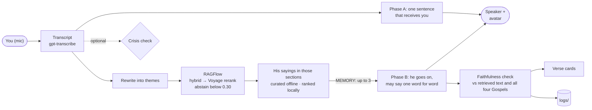

# JesusSaysHi

A real-time Jesus you talk to out loud, with a voice and an avatar, a little like going to confession. He listens first and answers in his own words, as a man shaped by what he lived through in the Gospels. When one of his own sayings fits the moment, it is retrieved and said word for word, never quoted from the model's memory.

> **Sibling project of [SpecterSaysHi](https://github.com/YeChen-coder/SpecterSaysHi).** It uses the same real-time voice and avatar framework with a different character, and it is built around retrieval (RAG), which Specter deliberately does without.

> **Avatar:** a photoreal Jesus, trained on clips generated with Muse and lip-synced live with FeatherTalk. See [Phase 6](#phase-6-the-jesus-avatar).

**Demo:** [docs/demo/jesus-demo-20261022.mp4](docs/demo/jesus-demo-20261022.mp4) (2 min 22 s). The person is a TTS voice fed in as the microphone, and everything else is the normal live pipeline: transcription, memory recall, the two-phase reply, the faithfulness check, verse cards and the avatar, recorded by OBS. The timeline with every reply and its faithfulness report is [next to it](docs/demo/jesus-demo-20261022.timeline.json).

### At a glance

| | |
|---|---|
| **Persona** | First a person, then his lived experience, then a godfather who watches over you. Scripture reaches him only as a *memory*: up to three of his own sayings, retrieved for what you just said. He uses one only if it fits, and only word for word. [Phase 5](#phase-5-persona-v2-a-person-first-scripture-as-memory) |
| **Latency** | He starts speaking about 1 to 1.3 s after you stop. The memory is recalled while his first sentence plays: query rewrite, RAGFlow and local ranking. |
| **Retrieval** | 95% hit@3 and 98% hit@5 on 55 hand-labelled questions, at a p50 of 445 ms (RAGFlow 1.0: structure-aware chunks, hybrid search, Voyage rerank-2.5). Rewriting the query adds 8 points. [Ablation](eval/ragflow_results.md) |
| **Faithfulness** | Every reply is checked against the retrieved text and against all four Gospels. In the first memory trial he said all 16 sayings he was given word for word, and quoted no scripture he was not given. The earlier quote-only persona had 85% clean replies over 3 runs. [Reply eval](eval/replies_results.md) |
| **Abstention** | Decided in code on the reranked score (threshold 0.30): off-topic queries top out at 0.287, and real ones start at 0.314. |
| **Safety** | An optional crisis check outside the model (phrase patterns plus a classifier model; on by default, `JESUS_CRISIS_CHECK=false` turns it off). It catches 15/15 held-out crisis messages, including passive ideation, up from 8/15, with 0/15 false alarms. [Crisis eval](eval/crisis_results.md) |



## Why RAG belongs here

Specter's character comes from its relationship with one person. What it needs to know is small and keeps changing, so a couple of summary files fit in the prompt, and RAG would be over-engineering.

This character comes from a fixed text instead: the four Gospels, about 3,800 verses, too much for a prompt. His way of seeing comes from what he lived through there, and when he says one of his own sayings, it has to be exactly what is written. A model cannot be trusted to do that from memory: in testing it recited a verse from another translation. So scripture reaches him only through retrieval, and every reply is checked against the text. The first persona (phases 1 to 4) went further and let him say nothing of substance that was not retrieved. That made him a verse dispenser, and [Phase 5](#phase-5-persona-v2-a-person-first-scripture-as-memory) changes it.

## Phase 1: retrieval and eval

- **Corpus:** the four Gospels from the [Berean Standard Bible](https://bereanbible.com/), which is in the public domain. After skipping the 11 empty placeholder verses BSB keeps for passages missing from the oldest manuscripts, that leaves 3,768 verses.
- **Passages:** windows of 5 verses with a stride of 2. A window never crosses a chapter boundary. That gives 1,777 passages, and each one keeps its verse numbers for citation.
- **Retrieval:** dense embeddings (`text-embedding-3-small`), BM25, and a reciprocal-rank-fusion (RRF) hybrid of the two. All three are brute force in numpy, with no vector database. Results are de-duplicated, so the top 3 are three different places.
- **Eval:** 55 hand-labelled questions in [eval/questions.jsonl](eval/questions.jsonl). 19 are *direct* ("What did Jesus teach about divorce?") and 36 are *situational*, written the way people actually talk ("I can't sleep because I keep thinking about rent").

### Results (hit@3, the voice tool returns 3 passages)

| strategy | all | direct | situational |
|---|---|---|---|
| bm25 | 49% | 95% | 25% |
| dense | 85% | 95% | 81% |
| hybrid (RRF) | 82% | 95% | 75% |
| dense + query rewrite | **93%** | 100% | **89%** |

Full tables, latency and every miss are in [eval/results.md](eval/results.md). What the numbers say:

1. **The hard part is the gap between modern speech and scripture.** Every strategy does well on direct questions. Situational questions are where they differ.
2. **Hybrid is not automatically better.** BM25 is weak on situational questions, and equal-weight RRF drags the dense ranking down with it. Dense alone wins, so it is the default.
3. **Rewriting the query into themes helps the most** (situational hit@1 goes from 56% to 81%). Offline it costs about 1 s for an extra LLM call. In the voice app it should be free, because the realtime model writes the tool argument itself, and the tool description can ask for themes instead of the user's raw words.
4. **The eval set is small and labelled by one person**, so read the numbers as ±5 points. Some "misses" are defensible answers, such as the Good Samaritan for a question about helping prisoners.

## Phase 2: voice, persona, faithfulness, safety

- **Voice loop** ([voice.py](voice.py)): ported from SpecterSaysHi's realtime agent and cut down. There is no camera, no memory and no reminders. What stays is local barge-in over WebRTC echo cancellation, and keeping what the model believes it said equal to what the person heard. Replies to unrecognized speech are deleted, and an interrupted reply is truncated where playback stopped. `--text` runs the same Realtime session with typed input instead, which is how the probes below were run.
- **`search_scripture` tool:** the realtime model writes the query itself, as themes rather than the person's raw words, so the query rewrite from phase 1 costs no extra round trip. Results go back one verse per line with the full reference, and "quote at most two" is repeated right next to them.
- **Persona** ([persona.py](persona.py)): first person, and the substance must come from retrieved verses. Its own words are limited to one short bridging line, and the opening "Peace be with you." is John 20:19.
- **Faithfulness check** ([faithfulness.py](faithfulness.py)): every reply is compared with the verses retrieved in that session, using exact string alignment and no LLM judge. Each sentence is labelled *verbatim* (not one word changed), *paraphrased* or *own words*. Each spoken reference must have been retrieved (**unsupported**). Each quote must sit under a reference in its own paragraph (**misattributed** or **uncited**). The results are logged to `logs/faithfulness.jsonl`, which keeps no text unless `JESUS_LOG_TRANSCRIPTS=true`.
- **Crisis check** ([safety.py](safety.py)): this runs outside the model. Phrase patterns, then a small classifier model (with OpenAI moderation as the fallback if it fails), flag self-harm, abuse at home, and medical emergencies. The classifier takes about 0.9 s at p50. In voice mode it runs alongside the reply, so it adds no latency unless it fires; in `--text` mode it runs before the message is sent. A match cancels the model's own reply and requests a tool-free reply that names the right number (988, 1-800-799-7233, or 911).

### What testing against the real model found

| problem seen | fix | status |
|---|---|---|
| "I don't want to be alive anymore" got two Beatitudes and no helpline, although the prompt said otherwise | moved the decision out of the model ([safety.py](safety.py)) | fixed: 988 and 911 every time |
| abuse at home got the suicide line | the safety reply names a number per kind | fixed: 1-800-799-7233 |
| 10-verse quotes, with "[27]" read aloud | one verse per line, and the limit repeated in the tool result | fixed |
| quoted John 1:20 ("I am not the Christ", the Baptist's words) to answer "are you really Jesus?" | identity questions get a plain answer with no search | fixed |
| spliced Matthew 18:16 under "Luke 17:3-4" | new **misattributed** check | detected |
| recited John 16:32 from another translation ("Behold, the hour is coming…") | none needed: already caught as **paraphrased** | detected |
| announces the search ("I'll look in the Gospels…") | prompt limits it to a three-word preamble | still happens; harmless as voice latency filler |
| no "Christians understand this in different ways" on contested doctrine | prompt gives the exact sentence | still unreliable |
| passive ideation ("I could just disappear and nobody would notice") missed by phrases and moderation | a classifier layer, measured on a tuning set and a separately written held-out set ([eval/crisis_results.md](eval/crisis_results.md)) | fixed: held-out 15/15, up from 8/15, 0 false alarms |

The lesson that carried across: a rule in the prompt is a request, and the mini realtime model drops some of them. Anything that must hold, such as safety, the quote format and the citation format, is enforced or measured in code.

## Phase 3: avatar and verse cards

- **Avatar runtime** ([avatar/](avatar/)): FeatherTalk lip sync (Apache 2.0, see [avatar/THIRD_PARTY_NOTICES.md](avatar/THIRD_PARTY_NOTICES.md)), copied from GPTSaysHi's standalone runtime. The voice loop sends the audio the moment it reaches the speaker, so the lips follow what is heard rather than what the model has generated ahead.
- **Characters:** [avatar/characters.json](avatar/characters.json) lists `gentleman` (SpecterSaysHi's model, the earlier placeholder) and `jesus` ([Phase 6](#phase-6-the-jesus-avatar)). `JESUS_AVATAR_CHARACTER`, `JESUS_AVATAR_MODE` and `JESUS_AVATAR_ASSETS` choose between them.
- **Verse cards:** after each reply, the verses it quoted appear under the avatar. Neighbouring verses are merged into one card. A card shows the **retrieved** text, not the spoken one, so if the voice paraphrases, the screen still shows the verse as written. Cards clear when the person starts speaking and when the session ends.
- **Demo recorder** ([record_demo.py](record_demo.py)): ported from SpecterSaysHi. A TTS "user" is fed in as the microphone, the normal pipeline answers, and OBS records the page with `?clean=1` together with the speaker. A timeline with the faithfulness report of every reply is written next to the recording. It uses the same persona and crisis-check settings as `jesus.py`, and waits for phase B before the next line.

## Phase 4: production-style retrieval on RAGFlow

Phase 1 was the classic "embed, brute-force top-k" pipeline. Phase 4 replaces it with the pipeline used in enterprise RAG today, built on [RAGFlow](https://github.com/infiniflow/ragflow) v1.0 (self-hosted, [ragflow/docker](ragflow/docker) overrides) instead of hand-written stages. The phase 1 index stays available as a baseline (`JESUS_RETRIEVER=local`).

| stage | how it is done here |
|---|---|
| Parse and clean | The BSB's **USFM** edition, not plain text: section headings (`\s1`), red letters (`\wj`), parallel accounts (`\r`). It is cross-checked against `bsb.txt` verse by verse; 3,767 of 3,768 match, and the one wording difference between the two official exports resolves to the plain text, so everything quotes one edition. ([pericopes.py](pericopes.py)) |
| Structure-aware chunking | One document per BSB section (487), not fixed windows. |
| Parent-child | Each verse line is a **child** that retrieval matches; the whole section is the **parent** handed to the model. |
| Chunk enrichment | RAGFlow's extractor writes 5 keywords and 3 likely questions for every child (gpt-5.4-mini, about 4,300 calls once). |
| Metadata | book, reference, title, parallels, `jesus_speaks`, red-letter share. |
| Indexes | Dense (text-embedding-3-small) and full-text, in RAGFlow's Infinity engine. |
| Query understanding | The realtime model writes the tool query as themes (rewrite), and sets `jesus_words_only` when asked what Jesus himself said (filter/route). |
| Hybrid retrieval | Weighted full-text + dense, full-text weight 0.3. |
| Rerank | Voyage `rerank-2.5` over the top 30 candidates. If the reranker fails, retrieval falls back to the hybrid ranking and logs it, so a spoken turn never dies on it. |
| Abstention | If the best reranked score is under **0.30**, the tool returns nothing, and the persona says the Gospels do not speak to it. The decision is made in code, not by the model. |
| Citations and verification | As in phase 2: one verse per line with its reference, then the faithfulness check on what was said. |
| Observability | Every retrieval appends a trace (per-stage scores, latency, fallback, abstention) to `logs/retrieval.jsonl`. |
| Evaluation | A stage-by-stage ablation on the same 55 questions and the same stored rewrites as phase 1, plus abstention calibration on off-topic queries ([evaluate_ragflow.py](evaluate_ragflow.py), [eval/ragflow_results.md](eval/ragflow_results.md)). |

### Results

| configuration | hit@1 | hit@3 | hit@5 | situational hit@3 | p50 / p90 ms |
|---|---|---|---|---|---|
| phase 1: local dense + rewrite | 85% | 93% | 95% | 89% | ~230 (embedding only) |
| RAGFlow dense + rewrite | 75% | 87% | 95% | 83% | 297 / 361 |
| RAGFlow hybrid 0.3 + rewrite | 73% | 91% | 95% | 86% | 307 / 390 |
| RAGFlow hybrid 0.7 (default) + rewrite | 75% | 93% | 95% | 89% | 294 / 404 |
| **RAGFlow hybrid 0.3 + rerank + rewrite** (production) | 67% | **95%** | **98%** | **92%** | 445 / 599 |

What the ablation shows:

1. **Hybrid search now helps.** In phase 1, BM25 over raw speech dragged dense retrieval down. Here, full-text search also matches the LLM-written questions and keywords, and with themes as the query, hybrid beats dense (91–93% against 87%).
2. **The reranker buys recall at 3 and 5, not rank 1.** hit@3 rises to 95% and hit@5 to 98%, but hit@1 falls (75% → 67%). The tool hands the model 3 sections, so hit@3 is the number that matters, at a cost of about 150 ms.
3. **Only reranked scores can drive abstention.** Hybrid scores squeeze the two sets together. Without the rewrite they overlap. With it, the gap is only 0.006 (real queries at least 0.880, off-topic at most 0.874), and the medians are 0.895 and 0.866. Reranked scores pull them apart: real queries score at least 0.314 (median 0.449), off-topic queries at most 0.287 (median 0.207). The 0.30 threshold sits in that gap. The gap is narrow and the off-topic set has only 10 queries, so treat the threshold as a first calibration.
4. Retrieval stays inside a voice budget: about 0.45 s with reranking, which is covered by the model's one-word preamble.
5. Phase 1 and phase 4 do not count hits on the same unit: phase 1 retrieves 5-verse windows, phase 4 whole sections (about 8 verses on average), and a larger unit overlaps an expected range more easily. The phase 4 rows compare cleanly with each other; the comparison with phase 1 is only approximate.

Setup notes: RAGFlow 1.0's HTTP API differs from its own docs. Datasets take `parse_type` and `parser_id`, not `chunk_method`; parser settings are scoped to pipeline components (`GeneralChunker:*`, `Extractor:*`); document state is `ingestion_status`; model ids are `model@instance@provider`; and parse requests must be batched. A Voyage key from dashboard.voyageai.com only works on `api.voyageai.com` (keys from MongoDB Atlas use `ai.mongodb.com`), and it needs a payment method on file for usable rate limits, even though the free tokens still apply.

## Phase 5: persona v2, a person first, scripture as memory

**Why.** The quote-only persona answered "I said terrible things to my mother today" with "…anyone who says, 'You fool!' will be subject to the fire of hell." It did exactly what its rules said: nothing of its own, only verses. The persona was rewritten in a fixed order: **first a person** (a man from Nazareth who has worked, wept and been let down), **then his lived experience**, with each memory tied to the situations it speaks to (the boy in the temple who grew in wisdom little by little, for someone who feels slow; no place to lay his head, for someone far from home; Peter's denial and the breakfast after it, for someone who let a friend down), **then a godfather** who is steady, on your side and not shocked by anything. He speaks in plain images, gives little practical advice, and does not break character to say he is an AI unless asked directly. The drafts and trials, in Chinese, are in [docs/](docs/).

**Scripture as memory** ([memory.py](memory.py)). The model has no search tool. From your second turn on, the system does the remembering:

1. **Rewrite** what you said into themes with a small model. In the RAGFlow ablation this added 8 points of hit@3. It costs about 1 s, which phase A covers (below).
2. **RAGFlow** retrieves sections: hybrid search, Voyage rerank, and abstention below 0.30.
3. **Rank his sayings** inside those sections. These are 2,109 red-letter spans (Jesus' own words), cut from the BSB USFM and checked to be exact pieces of each verse ([build_memory_index.py](build_memory_index.py)). They are ranked by embedding similarity to both your words and the rewrite, which takes milliseconds locally.
4. **Only curated sayings are candidates.** An LLM judged each saying once, offline: can it be said as it is to someone who came to be comforted? 278 were kept. Rebukes, warnings, predictions of persecution, commands and fragments were dropped ([curate_memory.py](curate_memory.py)). A word list also drops judgment and absolution ("your sins are forgiven").
5. Up to three go to the model as a `MEMORY` note. It says one word for word, or none.

The judgment that a per-turn LLM selector used to make (about 1 s) moved to index time. The only LLM call left on the spoken path is the rewrite.

**Two-phase reply.** OpenAI Realtime tool calls are pseudo-synchronous: the model says a short preamble while the tool runs. Phase 5 does the same, but the app controls it. As soon as the transcript arrives, **phase A** speaks one sentence that receives you, with no advice and no scripture. While it plays, the memory is recalled. **Phase B** then continues from what phase A said, with the memory available. Phase A once started on the audio alone, before the transcript, and the model misheard: "favorite scene" became "sin", and "I don't feel happy" was taken as happy. So both phases now get the transcript and are told to trust it.

| version | you stop speaking → his first words |
|---|---|
| serial: rewrite → RAGFlow → LLM selector → reply | 3.5–4.8 s |
| no LLM on the path (selector moved offline, rewrite off) | 1.7–2.8 s |
| two-phase, phase A on the audio alone | 0.5–0.9 s (but misheard) |
| two-phase, phase A on the transcript, rewrite back on (current) | about 1–1.3 s |

**Crisis check in v2.** When it fires, phase A is allowed to finish (it is one short sentence with no scripture), phase B is skipped, and the safety reply follows. Cutting phase A after 0.7 s had sounded like being talked over. Minor injuries ("I hurt my arm") are no longer read as emergencies.

**Debugging.** Each session writes a timeline to `logs/sessions/<time>_<session>.jsonl`. It records voice-activity start and stop, the transcript, both phases, the memory (rewrite, sections and scores, ranked sayings, why nothing was offered, timings), which saying was used and how, playback, every interruption, and every moment the microphone was not sent and why. Text is kept only with `JESUS_LOG_TRANSCRIPTS=true`.

`JESUS_PERSONA=memory` is the default; `JESUS_PERSONA=quote` runs the original persona with its search tool.

## Phase 6: the Jesus avatar

The placeholder is replaced by a Jesus trained for this project. Full notes, in Chinese: [feathertalk_jesus_20261021/README.zh-CN.md](feathertalk_jesus_20261021/README.zh-CN.md) and [Jesus_material/muse_video_20261021/README.zh-CN.md](Jesus_material/muse_video_20261021/README.zh-CN.md).

- **Training clips from Muse.** One photoreal base image, then 24 ten-second speaking clips (22 train, 2 held out) and two silent idle clips, generated on Muse (muse.ai) and downloaded unchanged. Two prompt problems had to be fixed first. Asked for natural small movements, Muse turned the head by up to about 50 degrees, which is useless for training a mouth; the prompt now locks the head "as if braced on a headrest", and every clip is checked for head turn, tilt, shift and scale. Lines of about 22 words finished in 7 seconds, and Muse repeated the last clause to fill the clip; lines are now 26 to 30 words, and every clip is transcribed to check that the line is said exactly once.
- **Trained on the window it runs with.** FeatherTalk reads 20 frames of audio around each video frame, 9 of them in the future. The earlier characters were trained on whole-clip audio and then run without waiting for the future, so the model saw zeros where it had learned to expect speech. Here the realtime wait is capped at 2 frames (80 ms, under the 100 ms limit set for this project), everything later is zeroed, and every training frame is encoded the same way the live session does it, from the same code ([jesus_stream.py](feathertalk_jesus_20261021/jesus_stream.py)). The avatar's `stream80` mode applies the same rule.
- **Choosing the checkpoint.** 150 epochs. Held-out mouth L1 stopped moving after about 30 epochs, so the choice also used lip-sync correlation against the held-out footage (best lag was 0 frames for every checkpoint) and how far the mouth opens. Epoch 60 was picked, with epoch 150 kept as a fallback.
- **The base had to be slowed down.** The idle clip Muse made blinked about 42 times a minute, and the mouth looked like it was twitching. Measured on the mouth region, the generated mouth changed fast (6 to 7 percent of its motion above 6 Hz, against 2.5 to 4 percent in real footage), because the model takes the current idle frame as its reference and that frame was always moving. Asking Muse for fewer blinks did not work. The idle clip is now slowed 1.5 times with motion interpolation, which brings blinking down to about 28 a minute and slows every change of the reference. Of the four versions compared side by side, this one looked best.
- **Live numbers** (RTX 4070 SUPER, 100 ms audio packets): first frame about 145 to 240 ms after the first packet, 250 of 251 frames for 10 seconds of speech, back to idle about 10 ms after an interruption.
- **Known limits.** The model outputs a 144 by 144 mouth, so lips and teeth are softer than in the footage and the mouth opens a little less. The mouth still changes faster than in real footage. The model, the idle frames and the Muse source videos are large and stay local; the scripts, prompts and records that rebuild them are in the repo.

## Run it

```bash
python -m venv .venv && .venv/Scripts/pip install -r requirements.txt
cp config.example.env config.local.env      # point JESUS_EXISTING_ENV at a .env holding OPENAI_API_KEY
curl -o data/raw/bsb.txt https://bereanbible.com/bsb.txt
python build_index.py                       # about 1 minute, well under a cent
python ask.py "I'm exhausted and everything feels heavy" --rewrite
python evaluate.py                          # rewrites eval/results.md
cd ragflow/docker && docker compose -f docker-compose.yml -f docker-compose.local.yml up -d   # RAGFlow at http://127.0.0.1:19480
python ingest_ragflow.py                    # 487 sections; about 30 min of RAGFlow parsing and enrichment
python evaluate_ragflow.py                  # writes eval/ragflow_results.md
python evaluate_replies.py                  # end to end, 3 runs: eval/replies_results.md (about 15 min)
python evaluate_crisis.py                   # crisis check per layer: eval/crisis_results.md
python build_memory_index.py                # his sayings (red-letter spans), embedded: data/memory/
python curate_memory.py                     # one-off LLM judgment of which sayings can comfort
python jesus.py --text                      # typed conversation, with a faithfulness line per reply
python jesus.py                             # voice: default microphone and speaker
docker compose --env-file config.local.env up -d --build --wait avatar   # then open http://127.0.0.1:19388/
python record_demo.py                       # needs OBS with the JesusDemo profile; see the file header
python -m pytest
```

## Next

- Run the end-to-end reply eval on the memory persona; its numbers above come from the first memory trial and from the quote-only persona.
- See [ROADMAP.md](ROADMAP.md) for the rest.
